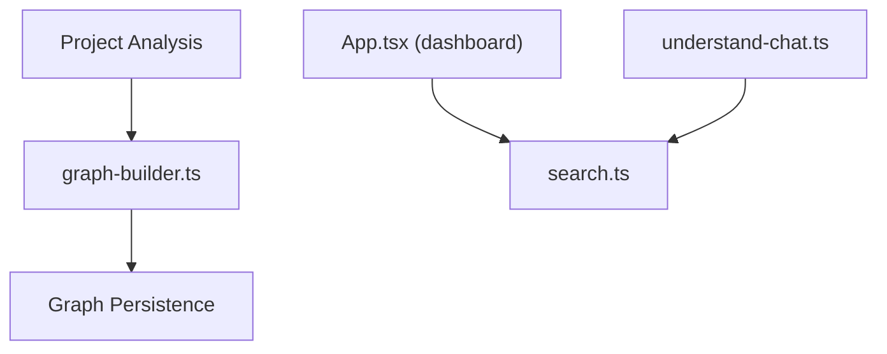

# Egonex-AI/Understand-Anything

> This is a plugin for a code agent that transforms a repository, a wiki, or Figma mockups into a knowledge graph.

## The problem
Understand a large codebase or knowledge base without having to read each file individually.

## What it actually does
The same README as Lum1104/Understand-Anything (same stars, same push date). The described architecture includes Figma design analysis. The workflow: project analysis, structure extraction, graph creation, enrichment (layers, paths, language lessons), followed by a dashboard with search, node details, code viewer, diff, chat, and onboarding.

## How it is wired


## Trying it
```bash
/plugin marketplace add Egonex-AI/Understand-Anything
/plugin install understand-anything
/understand
npx https://github.com/Egonex-AI/Understand-Anything/releases/latest/download/understand-anything-viewer.tgz /path/to/analyzed/project
```

## Cost and gotchas
"Premier" requires a significant number of tokens on a large project; incremental restarts. The viewer itself does not require a key or an LLM, only Node 18+.

## What it is not
Not a distinct duplicate: the content is identical to Lum1104/Understand-Anything, and the README itself points to Egonex-AI. The exact relationship between the two repositories (mirror, fork, or relocation) is not documented.

## Alternatives
No alternative is specified in the README.

## For you
This should be noted, and only used once: take the Egonex-AI URL, which is listed in the installation instructions in the README.
