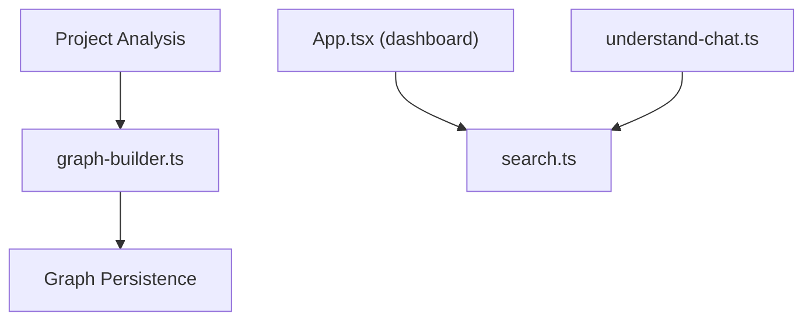

# Egonex-AI/Understand-Anything

> Plugin d'agent de code qui transforme un dépôt, un wiki ou des maquettes Figma en graphe de connaissances.

## Le problème
Comprendre un gros code ou une base de connaissances sans la lire fichier par fichier.

## Ce que ça fait vraiment
Même README que Lum1104/Understand-Anything (mêmes étoiles à deux près, même date de push). L'architecture décrite ajoute l'analyse de designs Figma. Le flux : analyse du projet, extraction de structure, graphe, enrichissement (couches, parcours, leçons de langage), puis dashboard avec recherche, détail de nœuds, visionneuse de code, diff, chat, onboarding.

## Comment c'est branché


## Essayer
```bash
/plugin marketplace add Egonex-AI/Understand-Anything
/plugin install understand-anything
/understand
npx https://github.com/Egonex-AI/Understand-Anything/releases/latest/download/understand-anything-viewer.tgz /path/to/analyzed/project
```

## Coût et pièges
Premier `/understand` coûteux en tokens sur un grand projet ; relances incrémentales. Le visualiseur seul ne demande ni clé ni LLM, seulement Node 18+.

## Ce que ce n'est pas
Pas un doublon distinct : le contenu est identique à Lum1104/Understand-Anything, le README lui-même pointe vers Egonex-AI. La relation exacte entre les deux dépôts (miroir, fork, déménagement) n'est pas documentée.

## Alternatives
Aucune alternative nommée dans le README.

## Pour toi
À surveiller, et à ne retenir qu'une seule fois : prends l'URL Egonex-AI, référencée dans les commandes d'installation du README.

