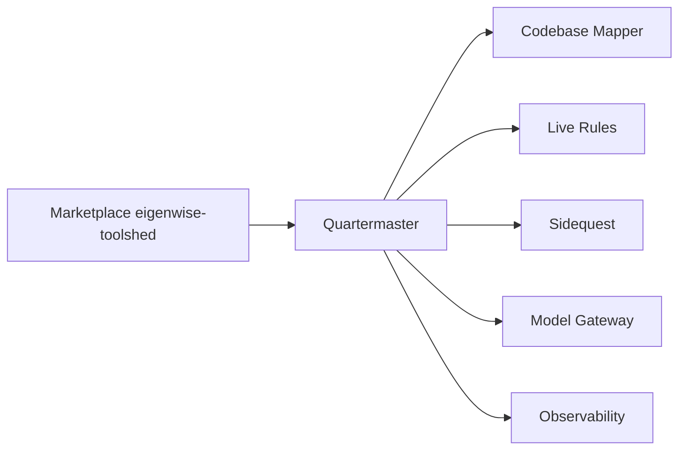

# Eigenwise/eigenwise-toolshed

> Marketplace of six Claude Code plugins: repository mapping, rules, tickets, model gateway, observability, guided installation.

## The problem
Claude Code makes you relearn the repository every session, loses side tasks, leaves usage invisible and complicates plugin installs and updates.

## What it actually does
Six independent plugins: Codebase Mapper (project map loaded at startup), Live Rules (rules reinjected when they apply), Sidequest (tickets, dispatch and verification before merge), Model Gateway (ChatGPT/Codex and Grok models in `/model` through a local gateway), Observability (local metadata, opt-in per project) and Quartermaster (recommends, installs and updates, one approved change at a time).

## How it is wired


## Trying it
```bash
/plugin marketplace add Eigenwise/eigenwise-toolshed
/plugin install quartermaster@eigenwise-toolshed --scope project
/reload-plugins
/quartermaster:setup
```

## Cost and gotchas
Free on the plugin side; Model Gateway requires access to the provider's subscriptions and a local process. Quartermaster may run web searches with generic terms, and its updater touches all registered Toolshed installs, including in other projects. No telemetry is enabled by default.

## What it is not
Not a standalone tool: everything runs inside Claude Code. Model Gateway is only useful for non-Claude routes. The repository is four months old and has 52 open issues.

## Alternatives
No alternative named in the README.

## For you
Worth watching if you use Claude Code heavily: Live Rules and Codebase Mapper address real frictions, but the whole is recent and should be tested one plugin at a time.
