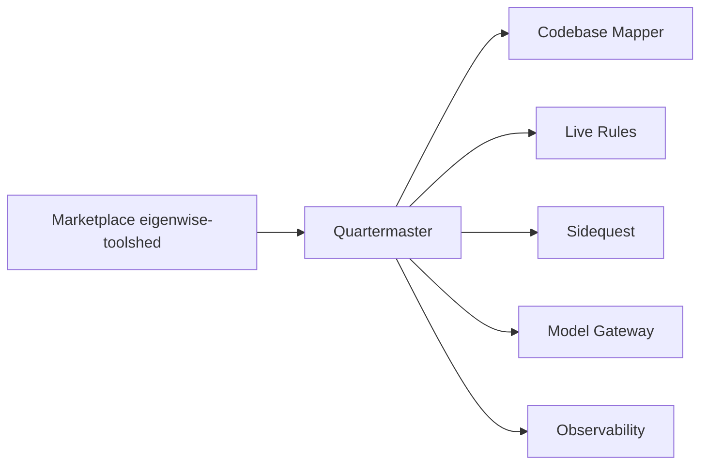

# Eigenwise/eigenwise-toolshed

> Marketplace de six plugins Claude Code : cartographie du dépôt, règles, tickets, passerelle de modèles, observabilité, installation guidée.

## Le problème
Claude Code oblige à réapprendre le dépôt à chaque session, perd les tâches annexes, laisse l'usage invisible et complique installations et mises à jour de plugins.

## Ce que ça fait vraiment
Six plugins indépendants : Codebase Mapper (carte du projet chargée au démarrage), Live Rules (règles réinjectées quand elles s'appliquent), Sidequest (tickets, dispatch et vérification avant intégration), Model Gateway (modèles ChatGPT/Codex et Grok dans `/model` via une passerelle locale), Observability (métadonnées locales, opt-in par projet) et Quartermaster (recommande, installe et met à jour, un changement approuvé à la fois).

## Comment c'est branché


## Essayer
```bash
/plugin marketplace add Eigenwise/eigenwise-toolshed
/plugin install quartermaster@eigenwise-toolshed --scope project
/reload-plugins
/quartermaster:setup
```

## Coût et pièges
Gratuit côté plugins ; Model Gateway demande un accès aux abonnements du fournisseur et un processus local. Quartermaster peut effectuer des recherches web avec des termes génériques, et son updater touche tous les installs Toolshed enregistrés, y compris dans d'autres projets. Aucune télémétrie n'est activée par défaut.

## Ce que ce n'est pas
Ce n'est pas un outil autonome : tout tourne dans Claude Code. Model Gateway n'est utile que pour les routes non-Claude. Le dépôt a quatre mois et 52 issues ouvertes.

## Alternatives
Aucune alternative nommée dans le README.

## Pour toi
À surveiller si tu fais un usage intensif de Claude Code : Live Rules et Codebase Mapper répondent à des frictions réelles, mais l'ensemble est récent et à tester un plugin à la fois.

