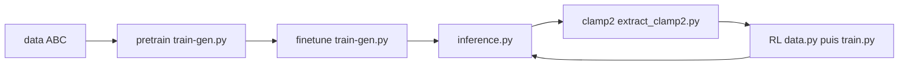

# ElectricAlexis/NotaGen

> Classical sheet-music generation models in ABC notation, trained in three stages including annotation-free RL.

## The problem
Generating quality symbolic music, with a chosen period, composer and instrumentation.

## What it actually does
Three sizes (110M, 244M, 516M parameters), pre-trained on 1.6M pieces, fine-tuned on about 9,000 works, then optimized by CLaMP-DPO (preferences based on CLaMP 2 scores). NotaGen-X adds a post-training stage. Local and online Gradio demo, ABC/MusicXML conversion, example on Schubert lieder.

## How it is wired


## Trying it
```bash
conda create --name notagen python=3.10
conda activate notagen
conda install pytorch==2.3.0 pytorch-cuda=11.8 -c pytorch -c nvidia
pip install accelerate optimum
pip install -r requirements.txt
cd finetune/ && CUDA_VISIBLE_DEVICES=0 python train-gen.py
```

## Cost and gotchas
NotaGen-large requires at least 24 GB of GPU to fine-tune and run inference; about 8 GB for NotaGen-X locally. Weights must be downloaded separately, as well as those of CLaMP 2. Last push in April 2025.

## What it is not
The pre-trained weights alone cannot generate on a "period-composer-instrumentation" prompt. The Schubert example does not use this conditioning.

## Alternatives
No alternative named in the README.

## For you
Worth watching: a clear recipe of RL without manual reward that could be transposed to other generative models, but the repository has been frozen since April 2025.
