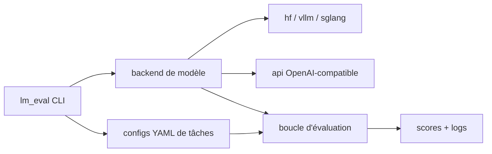

# EleutherAI/lm-evaluation-harness

> Unified framework to evaluate generative language models on dozens of benchmarks.

## The problem
Each paper evaluates with its own prompts and its own splits, so two published scores
on the same task are not comparable.

## What it actually does
Over 60 standard academic benchmarks, with hundreds of subtasks. Tasks are
defined by YAML configuration with Jinja2 prompts, output post-processing, answer
extraction and few-shot setup. Many backends: transformers (with quantization),
vLLM, SGLang, NeMo, Megatron-LM, OpenVINO, ONNX Runtime and ONNX Runtime GenAI, llama.cpp, commercial
APIs, LoRA adapters via PEFT, and steering vectors (`--model steered`).

## How it is wired


## Trying it
```bash
git clone --depth 1 https://github.com/EleutherAI/lm-evaluation-harness
cd lm-evaluation-harness
pip install -e .
pip install "lm_eval[hf,vllm,api]"
lm-eval ls tasks
lm_eval --model hf --model_args pretrained=EleutherAI/gpt-j-6B --tasks hellaswag --device cuda:0 --batch_size 8
```

## Cost and gotchas
Free, but model backends are installed separately via extras — the base install
evaluates nothing. A CUDA GPU is expected for most uses. GGUF models without a separate tokenizer may
take hours or hang while rebuilding the tokenizer. No native multi-node evaluation.
`data_parallel_size>1` in vLLM requires `pip install ray`.

## What it is not
It is not an online leaderboard: it is the engine behind Hugging Face's Open LLM Leaderboard,
not the table itself. vLLM outputs sometimes differ from Hugging Face, which is the
reference. `loglikelihood_rolling` (perplexity, wikitext) is not implemented for the `gguf` type.

## Alternatives
No external alternative is named; the README points to the GPT-NeoX integration for multi-machine
scenarios.

## For you
It is the reference tool whenever you need to quantify a quality regression after fine-tuning or
quantization — worth keeping even if you only use three tasks.
