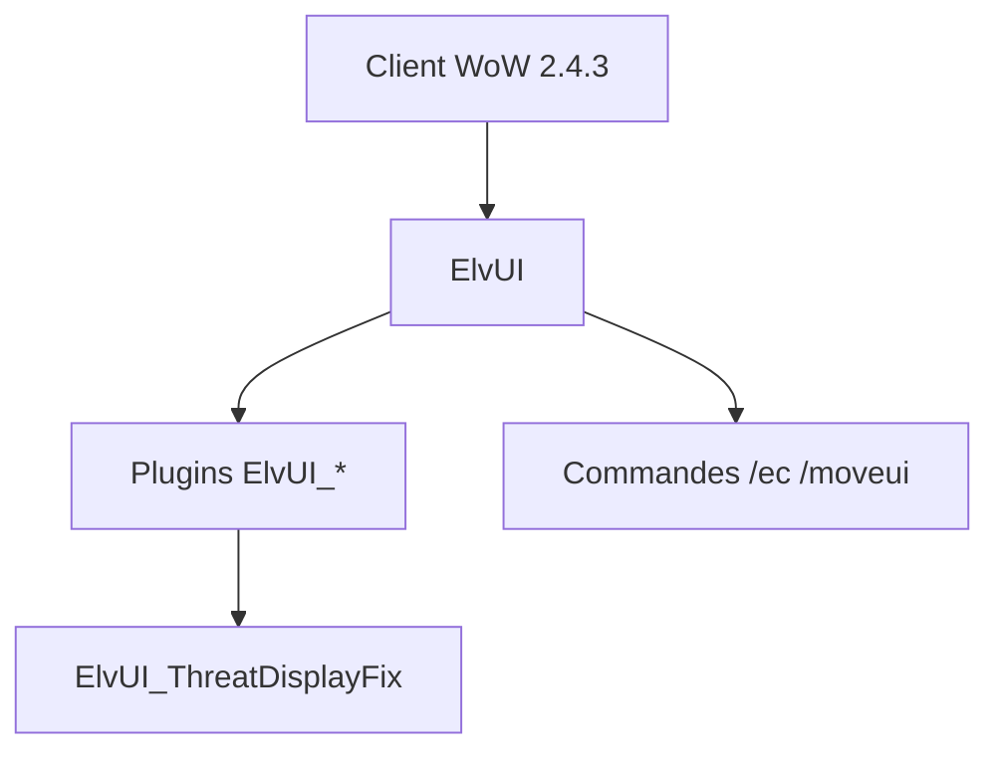

# ElvUI-TBC/ElvUI

> Complete replacement of the World of Warcraft Burning Crusade 2.4.3 interface, ported from ElvUI.

## The problem
The game's original interface is inflexible; this addon replaces it entirely.

## What it actually does
Lua addon that replaces the Blizzard interface at every level, with commands such as /ec, /moveui or /resetui, companion plugins and several languages. Threat highlights do not work without a fix plugin.

## How it is wired
Simplified diagram based on the card, no diagram provided.



## Trying it
```bash
# Commandes en jeu : /ec ou /elvui (configuration), /rl (recharger), /moveui (déplacer les cadres)
```

## Cost and gotchas
Free, but the repository is archived, last push in 2020 and no license. The game client from that era is required.

## What it is not
Not the current version of ElvUI: a frozen backport for an old game.

## Alternatives
- ElvUI_Enhanced: repository cited by the README for feature requests.

## For you
Ignore: an archived game addon, off-topic for a data / AI / MLOps profile.
