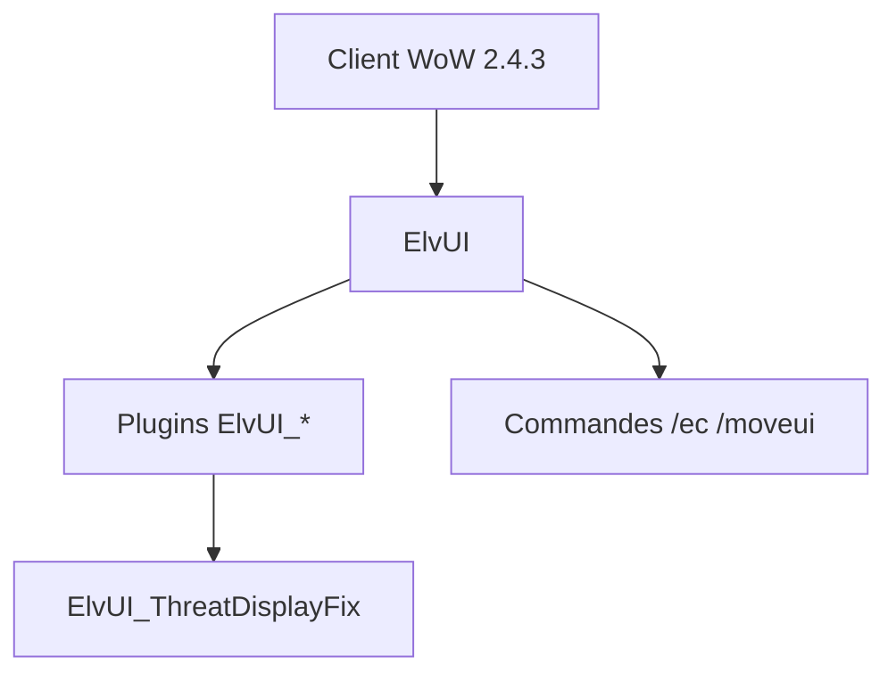

# ElvUI-TBC/ElvUI

> Remplacement complet de l'interface de World of Warcraft version Burning Crusade 2.4.3, porté depuis ElvUI.

## Le problème
L'interface d'origine du jeu est peu flexible ; cet addon la remplace en entier.

## Ce que ça fait vraiment
Addon Lua qui remplace l'interface Blizzard à tous les niveaux, avec des commandes comme /ec, /moveui ou /resetui, des plugins compagnons et plusieurs langues. Les surbrillances de menace ne fonctionnent pas sans un plugin correctif.

## Comment c'est branché
Schéma simplifié d'après la fiche, sans diagramme fourni.



## Essayer
```bash
# Commandes en jeu : /ec ou /elvui (configuration), /rl (recharger), /moveui (déplacer les cadres)
```

## Coût et pièges
Gratuit, mais dépôt archivé, dernier push en 2020 et licence absente. Il faut le client de jeu d'époque.

## Ce que ce n'est pas
Pas la version actuelle d'ElvUI : un rétroportage figé pour un jeu ancien.

## Alternatives
- ElvUI_Enhanced : dépôt cité par le README pour les demandes de fonctionnalités.

## Pour toi
Ignorer : un addon de jeu archivé, hors sujet pour un profil data / IA / MLOps.

