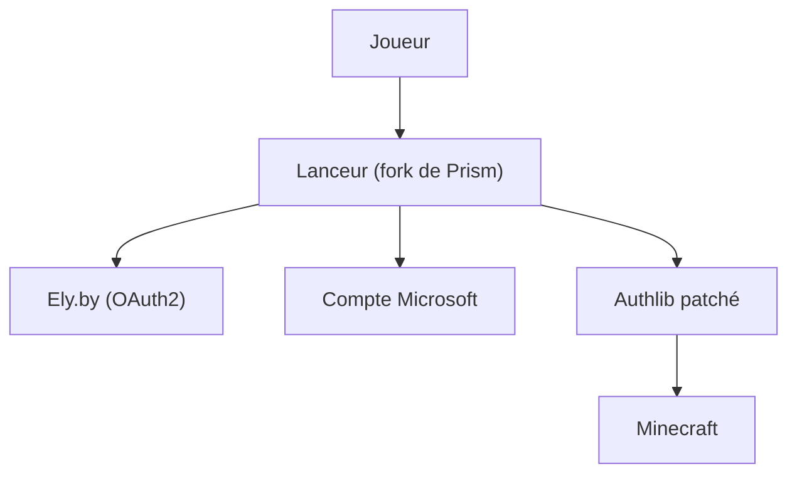

# ElyPrismLauncher/Launcher

> Fork of Prism Launcher (Minecraft) adding login with an Ely.by account.

## The problem
Minecraft launchers require a Microsoft account; other Ely.by forks ask for a password or don't display skins on all servers.

## What it actually does
Adds Ely.by login through OAuth2: credentials do not pass through the launcher. It uses Ely.by's official Authlib patches to display skins on servers without a dedicated plugin. Microsoft accounts remain usable. The rest comes from Prism Launcher.

## How it is wired
Simplified diagram based on the sheet, no diagram provided.



## Trying it
```bash
# Aucune commande documentée : téléchargements sur la page Releases.
# Compilation : voir les instructions de build liées dans le README.
```

## Cost and gotchas
Free. The README warns about malicious links imitating the project: download only from the official sites cited. Building without removing the API keys implies accepting the Microsoft and CurseForge terms.

## What it is not
Not the official Prism Launcher nor affiliated with it. It has no link with data or AI work.

## Alternatives
No alternative named in the README.

## For you
Ignore: a game launcher unrelated to a data, AI or MLOps profile.
