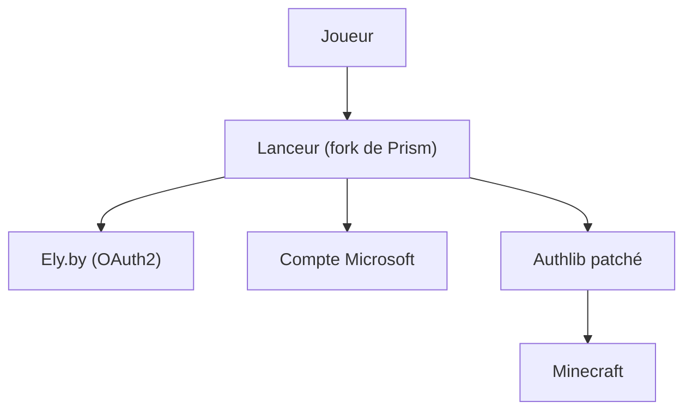

# ElyPrismLauncher/Launcher

> Fork de Prism Launcher (Minecraft) ajoutant la connexion par compte Ely.by.

## Le problème
Les lanceurs Minecraft exigent un compte Microsoft ; les autres forks Ely.by demandent un mot de passe ou n'affichent pas les skins sur tous les serveurs.

## Ce que ça fait vraiment
Ajoute la connexion Ely.by par OAuth2 : les identifiants ne passent pas par le lanceur. Il utilise les patchs Authlib officiels d'Ely.by pour afficher les skins sur les serveurs sans plugin dédié. Les comptes Microsoft restent utilisables. Le reste vient de Prism Launcher.

## Comment c'est branché
Schéma simplifié d'après la fiche, sans diagramme fourni.



## Essayer
```bash
# Aucune commande documentée : téléchargements sur la page Releases.
# Compilation : voir les instructions de build liées dans le README.
```

## Coût et pièges
Gratuit. Le README alerte sur des liens malveillants imitant le projet : télécharger uniquement depuis les sites officiels cités. Compiler sans retirer les clés d'API implique d'accepter les conditions Microsoft et CurseForge.

## Ce que ce n'est pas
Pas le Prism Launcher officiel ni affilié à lui. Il n'a aucun lien avec un travail data ou IA.

## Alternatives
Aucune alternative nommée dans le README.

## Pour toi
À ignorer : lanceur de jeu sans rapport avec un profil data, IA ou MLOps.

