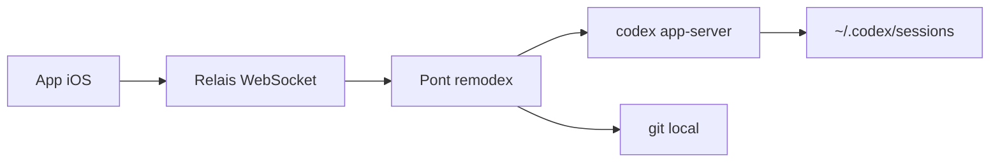

# Emanuele-web04/remodex

> Local bridge and iOS app to control Codex, which runs on your Mac, from your iPhone.

## The problem
Codex runs on the Mac; as soon as you move away from it, you cannot follow, restart or approve a running task.

## What it actually does
A Node bridge (`remodex`) launches `codex app-server` and relays JSON-RPC to the iPhone through a WebSocket relay. Pairing is done by QR code, then the channel is end-to-end encrypted (X25519, Ed25519, AES-256-GCM). The app offers plan mode, sub-agents, git actions, attachments, an SSH terminal. On macOS, a `launchd` service keeps the connection alive.

## How it is wired
```
iOS app ⇄ relais WebSocket ⇄ remodex (pont, Mac) ⇄ codex app-server
                                       │
                                  git local, ~/.codex/sessions
```


## Trying it
```bash
npm install -g remodex@latest
remodex up
codex login status
./run-local-remodex.sh
```

## Cost and gotchas
The app must be installed (App Store or Xcode 16+ build). Codex CLI must be authenticated on the Mac. The self-hosted relay is recommended via Tailscale; LAN over `ws://` is fragile on iOS.

## What it is not
Not a standalone client: without a powered-on Mac running Codex, nothing runs. The background service exists only on macOS. The author warns: very young project, expect bugs.

## Alternatives
No alternative named in the README.

## For you
Worth watching: handy if Codex is your main agent, but the relay, the home-grown encryption and the early status justify waiting before entrusting sensitive code to it.
