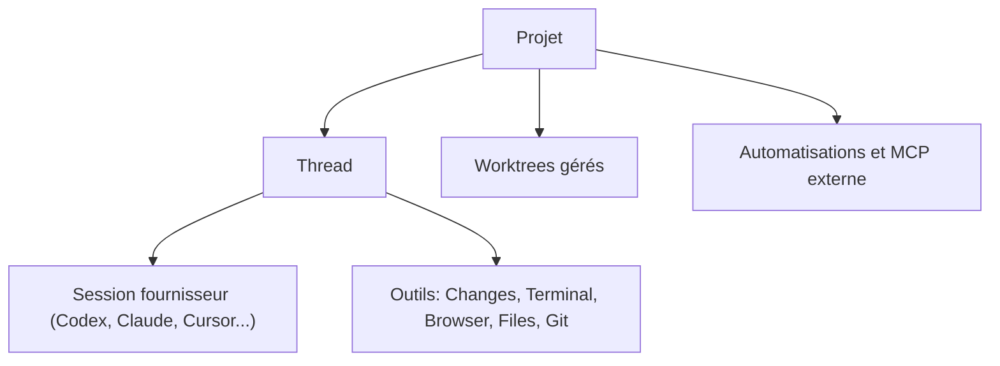

# Emanuele-web04/synara

> Local desktop application that brings together projects, coding agent sessions, terminal, browser and Git.

## The problem
Driving several coding agents (Codex, Claude, Cursor...) means juggling between terminals, editors, browsers and Git repositories.

## What it actually does
It organizes work into projects and discussion threads, each tied to an agent session installed and authenticated locally. Around the agent: diffs, terminal, browser, files, editor and Git actions. Managed worktrees isolate parallel tasks, with handoff from one agent to another, automations and external MCP.

## How it is wired
Simplified diagram based on the sheet, no diagram provided.



## Trying it
```bash
git clone https://github.com/Emanuele-web04/synara.git
cd synara
bun install
bun run dev
```

## Cost and gotchas
The application is free, but it relies on each agent's subscriptions and installations, at your expense. Git 2.29 or later is required. The development build requires Bun 1.4.4 and Node.js 24.13.1.

## What it is not
It is not an agent: it ships no model and orchestrates runtimes that are already installed. The README describes it as early stage, with APIs and an interface that are still moving.

## Alternatives
No alternative named in the README.

## For you
Worth watching: useful if you alternate between several coding agents and want a single control station, but the tool is young and shifting.
