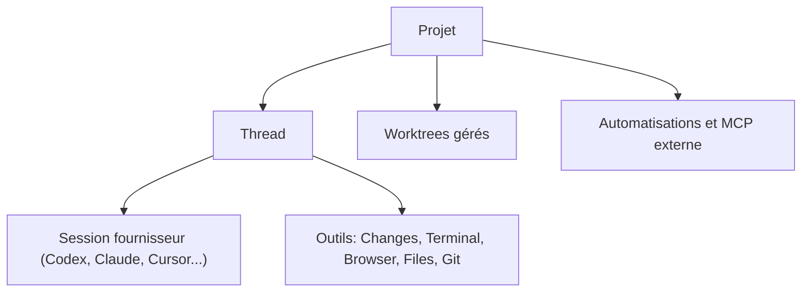

# Emanuele-web04/synara

> Application de bureau locale qui réunit projets, sessions d'agents de code, terminal, navigateur et Git.

## Le problème
Piloter plusieurs agents de code (Codex, Claude, Cursor...) oblige à jongler entre terminaux, éditeurs, navigateurs et dépôts Git.

## Ce que ça fait vraiment
Elle organise le travail en projets et fils de discussion, chacun lié à une session d'agent installée et authentifiée en local. Autour de l'agent : diffs, terminal, navigateur, fichiers, éditeur et actions Git. Des worktrees gérés isolent les tâches parallèles, avec transfert d'un agent à l'autre, automatisations et MCP externe.

## Comment c'est branché
Schéma simplifié d'après la fiche, sans diagramme fourni.



## Essayer
```bash
git clone https://github.com/Emanuele-web04/synara.git
cd synara
bun install
bun run dev
```

## Coût et pièges
L'application est gratuite, mais elle s'appuie sur les abonnements et installations de chaque agent, à ta charge. Git 2.29 ou plus est requis. Le build de développement demande Bun 1.4.4 et Node.js 24.13.1.

## Ce que ce n'est pas
Ce n'est pas un agent : elle n'embarque aucun modèle et orchestre des runtimes déjà installés. Le README la dit en phase précoce, avec des API et une interface encore mouvantes.

## Alternatives
Aucune alternative nommée dans le README.

## Pour toi
À surveiller : utile si tu alternes entre plusieurs agents de code et veux un seul poste de contrôle, mais l'outil est jeune et mouvant.

