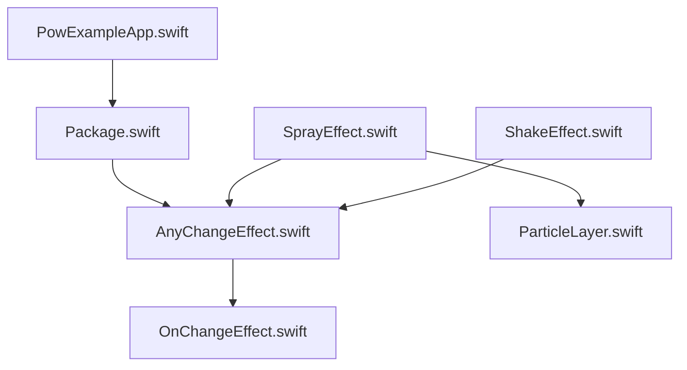

# EmergeTools/Pow

> SwiftUI library of visual effects and animated transitions, for iOS and macOS developers.

## The problem
Standard SwiftUI animations are limited: particles, shakes or glints require custom code.

## What it actually does
Two families: "change effects" triggered when a value changes (spray, haptic feedback, jump, ping, rise, shake, shine, spin, sound) and transitions under `movingParts` (anvil, blinds, blur, glare, iris, pop, poof, vanish, wipe...). A `ParticleLayer` keeps particles from being clipped by a parent.

## How it is wired
Diagram based on the one provided.



## Trying it
```swift
.package(url: "https://github.com/EmergeTools/Pow", from: Version(1, 0, 0))
.product(name: "Pow", package: "Pow")
```

## Cost and gotchas
Free. iOS 15, macOS 12, Mac Catalyst 15; visionOS in beta. Sound effects are not guaranteed (silent switch), so a visual cue is always needed.

## What it is not
Not a complete UI framework: an add-on to SwiftUI. It does not work outside the Apple ecosystem.

## Alternatives
No alternative named in the README.

## For you
Ignore: reserved for Apple apps, unrelated to data or AI.
