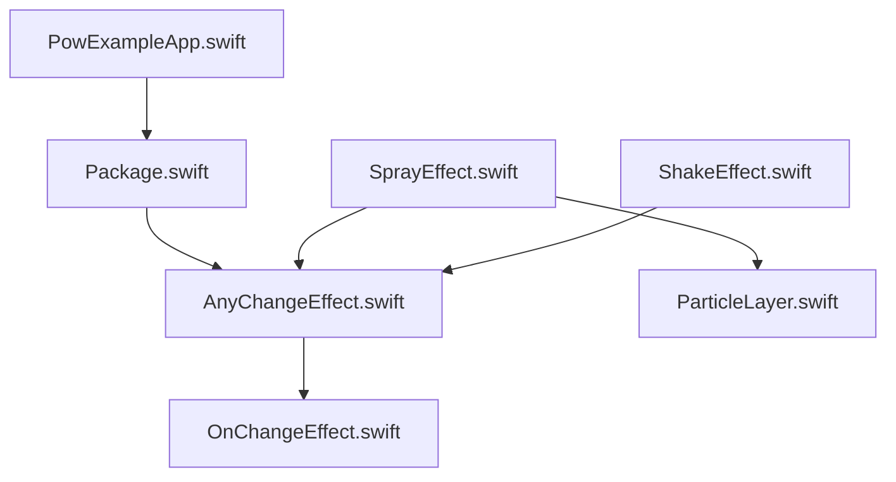

# EmergeTools/Pow

> Bibliothèque SwiftUI d'effets visuels et de transitions animées, pour développeurs iOS et macOS.

## Le problème
Les animations SwiftUI standard sont limitées : particules, secousses ou reflets demandent du code sur mesure.

## Ce que ça fait vraiment
Deux familles : des « change effects » déclenchés quand une valeur change (spray, retour haptique, jump, ping, rise, shake, shine, spin, son) et des transitions sous `movingParts` (anvil, blinds, blur, glare, iris, pop, poof, vanish, wipe…). Un `ParticleLayer` évite que les particules soient rognées par un parent.

## Comment c'est branché
Schéma d'après le diagramme fourni.



## Essayer
```swift
.package(url: "https://github.com/EmergeTools/Pow", from: Version(1, 0, 0))
.product(name: "Pow", package: "Pow")
```

## Coût et pièges
Gratuit. iOS 15, macOS 12, Mac Catalyst 15 ; visionOS en bêta. Les effets sonores ne sont pas garantis (interrupteur silencieux), il faut toujours un repère visuel.

## Ce que ce n'est pas
Pas un framework d'interface complet : un ajout à SwiftUI. Il ne fonctionne pas hors écosystème Apple.

## Alternatives
Aucune alternative nommée dans le README.

## Pour toi
À ignorer : réservé aux applis Apple, sans rapport avec les données ni l'IA.

