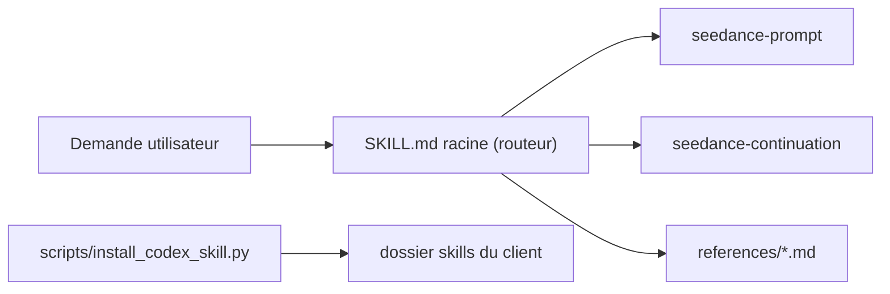

# Emily2040/seedance-2.0

> Agent skill that helps write Seedance 2.0 video prompts and chain shots.

## The problem
Writing a usable video prompt and keeping continuity between clips takes know-how the agent does not have by default.

## What it actually does
A package of sub-skills (interview, prompt, continuation, retake, copyright, QC) and dated references. The skill routes a request, separates the role of each reference (image, video, audio) and builds the next clip's prompt from the actual end of the accepted clip. A Python installer copies the skill into the agent's folder. The README says render scores and native-speaker reviews are pending.

## How it is wired


## Trying it
```bash
git clone https://github.com/Emily2040/seedance-2.0.git
cd seedance-2.0
python scripts/install_codex_skill.py --client codex --scope user
```

## Cost and gotchas
Generation is paid at the video provider; the skill says it does not authorize it on its own. The README is very long, installer included.

## What it is not
It is not a video generator nor proof of render quality: the validations concern the repository structure.

## Alternatives
No alternative named in the README.

## For you
Ignore on the data/AI side: a video-creation use case, with no demonstrated render quality.
