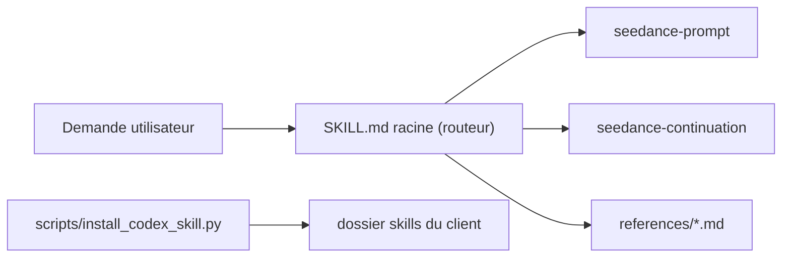

# Emily2040/seedance-2.0

> Skill d'agent qui aide à écrire des prompts vidéo Seedance 2.0 et à enchaîner des plans.

## Le problème
Écrire un prompt vidéo exploitable et garder la continuité entre clips demande un savoir-faire que l'agent n'a pas par défaut.

## Ce que ça fait vraiment
Un paquet de sous-skills (interview, prompt, continuation, retake, copyright, QC) et de références datées. Le skill route une demande, sépare le rôle de chaque référence (image, vidéo, audio) et construit le prompt du clip suivant à partir de la fin réelle du clip accepté. Un installeur Python copie le skill dans le dossier de l'agent. Le README dit que les scores de rendu et les revues de langues natives sont en attente.

## Comment c'est branché


## Essayer
```bash
git clone https://github.com/Emily2040/seedance-2.0.git
cd seedance-2.0
python scripts/install_codex_skill.py --client codex --scope user
```

## Coût et pièges
La génération se paie chez le fournisseur vidéo ; le skill dit qu'il ne l'autorise pas seul. Le README est très long, installeur compris.

## Ce que ce n'est pas
Ce n'est pas un générateur de vidéo ni une preuve de qualité de rendu : les validations portent sur la structure du dépôt.

## Alternatives
Aucune alternative nommée dans le README.

## Pour toi
À ignorer côté data/IA : usage de création vidéo, sans qualité de rendu démontrée.

