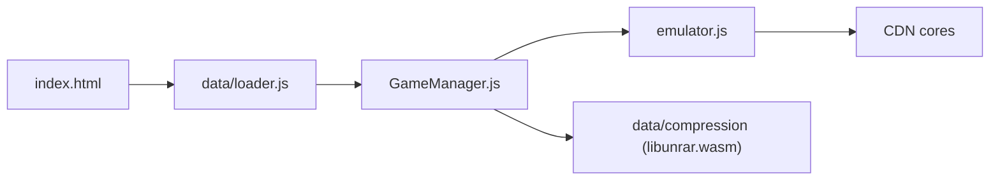

# EmulatorJS/EmulatorJS

> JavaScript library that runs console emulators in the browser, for web integrators.

## The problem
Offering retro games in a web page means assembling emulators, decompression, gamepads and localization yourself.

## What it actually does
A `loader.js` initializes the engine; `GameManager.js` and `emulator.js` drive the emulation core, with gamepad handling, shaders and storage. Archives (7z, zip, rar via `libunrar.wasm`) are decompressed client-side. Cores come from a public CDN, in stable, latest or nightly versions.

## How it is wired


## Trying it
```bash
npm i
npm run start
# puis http://localhost:8080/
```

## Cost and gotchas
Free. The "nightly" version is not recommended in production, "latest" is often less stable. Minify the scripts before deployment.

## What it is not
Not a standalone site nor a Docker container: it is a library to integrate. No ROM is provided. GPL-3.0: copyleft constraint on derivatives.

## Alternatives
- No alternative cited in the README.

## For you
Ignore: outside the data/AI/MLOps scope; only a retro-games web project would find any use for it.
