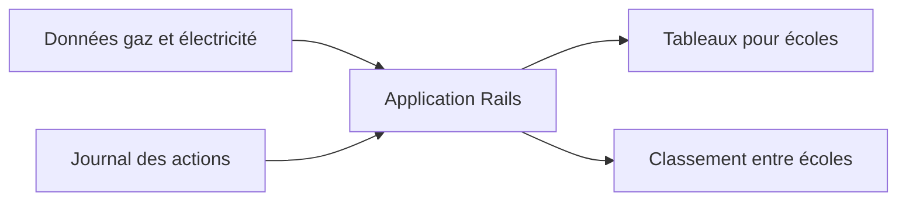

# Energy-Sparks/energy-sparks

> Open source Rails application that helps British schools track and reduce their energy consumption.

## The problem
Schools have a poor grasp of their gas and electricity consumption, and pupils do not see the effect of their actions.

## What it actually does
The application collects energy consumption data and presents it to staff, pupils and parents. It lets users record concrete actions and adds a competition dimension between schools. It relies on open data and aims for low-cost deployment.

## How it is wired
Simplified diagram based on the fiche, no diagram provided.

## Trying it
No command documented in the README: the developer guide is delegated to the project wiki.

## Cost and gotchas
Ruby on Rails required, installation described outside the README. No announced cost, but hosting remains your responsibility.

## What it is not
Not a general energy analysis tool: it targets British schools. User documentation is announced as in progress.

## Alternatives
No alternative named in the README.

## For you
Ignore: a business application for school awareness, with no reusable piece for a data, AI or MLOps profile.
