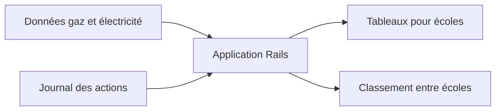

# Energy-Sparks/energy-sparks

> Application Rails open source qui aide les écoles britanniques à suivre et réduire leur consommation d'énergie.

## Le problème
Les écoles connaissent mal leur consommation de gaz et d'électricité, et les élèves ne voient pas l'effet de leurs gestes.

## Ce que ça fait vraiment
L'application collecte les données de consommation d'énergie et les présente au personnel, aux élèves et aux parents. Elle permet de consigner des actions concrètes et ajoute une dimension de concours entre écoles. Elle s'appuie sur des données ouvertes et vise un déploiement à faible coût.

## Comment c'est branché
Schéma simplifié d'après la fiche, sans diagramme fourni.

## Essayer
Aucune commande documentée dans le README : le guide développeur est renvoyé au wiki du projet.

## Coût et pièges
Ruby on Rails requis, installation décrite hors README. Aucun coût annoncé, mais l'hébergement reste à ta charge.

## Ce que ce n'est pas
Pas un outil général d'analyse énergétique : il vise les écoles britanniques. La documentation utilisateur est annoncée comme en cours.

## Alternatives
Aucune alternative nommée dans le README.

## Pour toi
À ignorer : application métier de sensibilisation scolaire, sans pièce réutilisable pour un profil data, IA ou MLOps.

