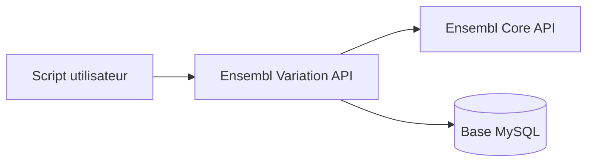

# Ensembl/ensembl-variation

> Perl API for accessing Ensembl genetic variations, a layer between the MySQL database and scripts.

## The problem
Querying the MySQL schema of genetic variations directly is heavy and fragile.

## What it actually does
Intermediate layer that encapsulates the database layout and offers high-level access. Requires the same version of the Ensembl Core API. Installation and tutorial are on the Ensembl website.

## How it is wired
Simplified diagram based on the sheet, no diagram provided.



## Trying it
```bash
git clone https://github.com/Ensembl/ensembl-variation.git
```

## Cost and gotchas
Free. You need the Core API of the same version and an Ensembl MySQL database. The language is not specified in the README.

## What it is not
Not an analysis tool: a data access layer. The README points to the website for everything else.

## Alternatives
No alternative named in the README.

## For you
Ignore: useful only in genomics; the data is accessible by other means in practice.
