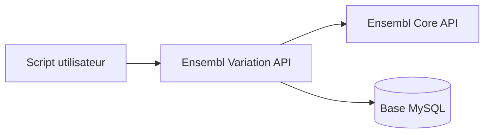

# Ensembl/ensembl-variation

> API Perl d'accès aux variations génétiques d'Ensembl, couche entre la base MySQL et les scripts.

## Le problème
Interroger directement le schéma MySQL des variations génétiques est lourd et fragile.

## Ce que ça fait vraiment
Couche intermédiaire qui encapsule la disposition de la base et offre un accès de haut niveau. Exige la même version de l'API Ensembl Core. Installation et tutoriel sont sur le site d'Ensembl.

## Comment c'est branché
Schéma simplifié d'après la fiche, sans diagramme fourni.



## Essayer
```bash
git clone https://github.com/Ensembl/ensembl-variation.git
```

## Coût et pièges
Gratuit. Il faut l'API Core de même version et une base MySQL Ensembl. Le langage n'est pas précisé dans le README.

## Ce que ce n'est pas
Pas un outil d'analyse : un accès aux données. Le README renvoie au site pour tout le reste.

## Alternatives
Aucune alternative nommée dans le README.

## Pour toi
À ignorer : utile seulement en génomique ; les données sont accessibles autrement en pratique.

