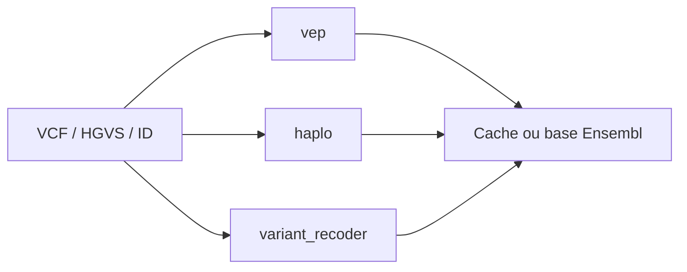

# Ensembl/ensembl-vep

> Predicts the functional effect of genomic variants, with Haplosaurus and Variant Recoder.

## The problem
Interpreting variants from a VCF file (effect on transcripts and proteins, HGVS nomenclature).

## What it actually does
VEP annotates variants; Haplosaurus builds transcript haplotypes from phased genotypes; Variant Recoder translates between encodings (identifiers, genomic HGVS, transcript, protein, SPDI) and requires access to the database. Perl; installation via `INSTALL.pl`. A long list of known bugs is documented.

## How it is wired


## Trying it
```bash
git clone https://github.com/Ensembl/ensembl-vep.git
cd ensembl-vep
perl INSTALL.pl
./vep -i input.vcf -o out.txt -offline
```

## Cost and gotchas
Free. Perl 5.22+, gcc, make; `DBD::mysql` for the database. Known bugs (multi-allelic with `--hgvs`, frequency filters on indels). The Conda package is not maintained by the team.

## What it is not
Not a variant caller: it annotates variants that have already been detected.

## Alternatives
No alternative named in the README.

## For you
Worth watching: a standard in genomics, useful only if your data is variants; otherwise out of scope.
