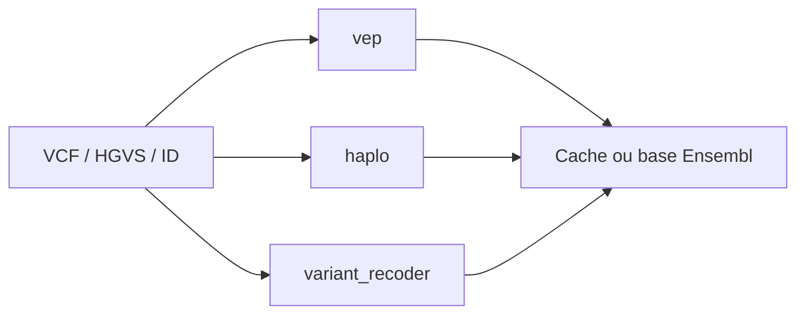

# Ensembl/ensembl-vep

> Prédit l'effet fonctionnel de variants génomiques, avec Haplosaurus et Variant Recoder.

## Le problème
Interpréter des variants d'un fichier VCF (effet sur transcrits et protéines, nomenclature HGVS).

## Ce que ça fait vraiment
VEP annote des variants ; Haplosaurus construit des haplotypes de transcrits à partir de génotypes phasés ; Variant Recoder traduit entre encodages (identifiants, HGVS génomique, transcrit, protéine, SPDI) et exige l'accès à la base. Perl ; installation par `INSTALL.pl`. Une longue liste de bogues connus est documentée.

## Comment c'est branché


## Essayer
```bash
git clone https://github.com/Ensembl/ensembl-vep.git
cd ensembl-vep
perl INSTALL.pl
./vep -i input.vcf -o out.txt -offline
```

## Coût et pièges
Gratuit. Perl 5.22+, gcc, make ; `DBD::mysql` pour la base. Bogues connus (multi-alléliques avec `--hgvs`, filtres de fréquence sur indels). Le paquet Conda n'est pas maintenu par l'équipe.

## Ce que ce n'est pas
Pas un appelant de variants : il annote des variants déjà détectés.

## Alternatives
Aucune alternative nommée dans le README.

## Pour toi
À surveiller : standard en génomique, utile seulement si tes données sont des variants ; sinon hors périmètre.

