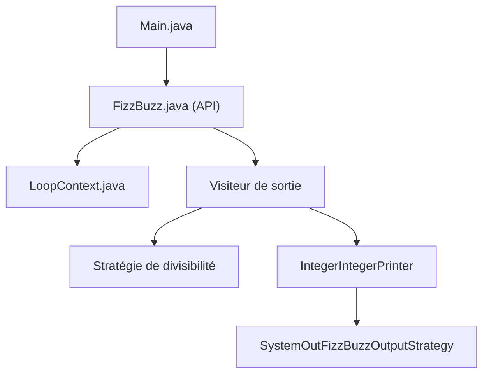

# EnterpriseQualityCoding/FizzBuzzEnterpriseEdition

> Java parody of the FizzBuzz game, over-engineered to illustrate the excesses of enterprise software.

## The problem
Showing what happens when design patterns are applied without restraint to a ten-line interview exercise.

## What it actually does
Reproduces FizzBuzz (from 1 to 100) with factories, visitors, divisibility strategies, loop contexts, printers and "returners". The architecture described: a Main entry point obtains an upper limit, calls the FizzBuzz interface, a context-driven loop applies the strategies, and an output strategy writes to the console.

## How it is wired

## Trying it
No command documented in the provided README.

## Cost and gotchas
Free, but no license: reuse is legally uncertain. Last push in July 2024. A JDK and a Java build tool are needed, not listed among the plan's prerequisites.

## What it is not
Not a tool or a library to reuse: it is a deliberately absurd example. The README does not present the parody as such, but its content makes it obvious.

## Alternatives
No alternative named in the README.

## For you
Ignore: entertaining for discussing over-engineering, with no practical value for data, AI or MLOps work.
