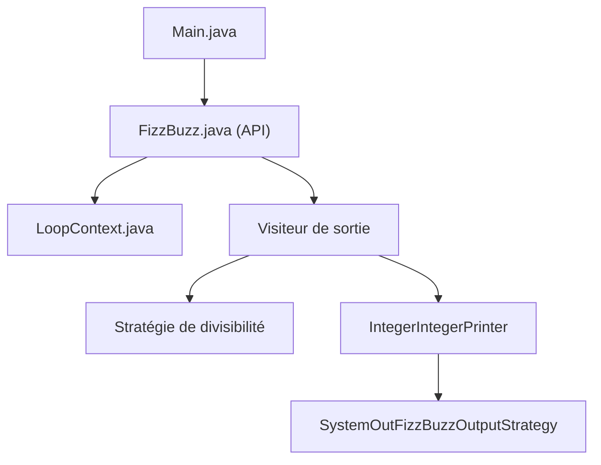

# EnterpriseQualityCoding/FizzBuzzEnterpriseEdition

> Parodie en Java du jeu FizzBuzz, sur-architecturée pour illustrer les excès du logiciel d'entreprise.

## Le problème
Montrer ce qui arrive quand on applique sans mesure les patrons de conception à un exercice d'entretien de dix lignes.

## Ce que ça fait vraiment
Reproduit FizzBuzz (de 1 à 100) avec fabriques, visiteurs, stratégies de divisibilité, contextes de boucle, imprimeurs et « returners ». L'architecture décrite : un point d'entrée Main obtient une limite haute, appelle l'interface FizzBuzz, une boucle pilotée par un contexte applique les stratégies, et une stratégie de sortie écrit sur la console.

## Comment c'est branché

## Essayer
Aucune commande documentée dans le README fourni.

## Coût et pièges
Gratuit, mais aucune licence : réutilisation juridiquement incertaine. Dernier push en juillet 2024. Il faut un JDK et un outil de construction Java, non listés parmi les prérequis du plan.

## Ce que ce n'est pas
Pas un outil ni une bibliothèque à réutiliser : c'est un exemple volontairement absurde. Le README ne présente pas la parodie comme telle, mais son contenu la rend évidente.

## Alternatives
Aucune alternative nommée dans le README.

## Pour toi
À ignorer : divertissant pour discuter de sur-ingénierie, sans valeur pratique pour un travail data, IA ou MLOps.

