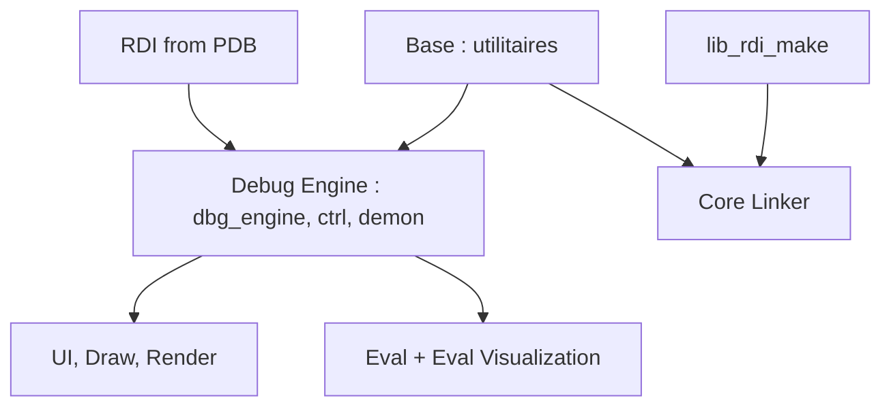

# EpicGamesExt/raddebugger

> Native x64 graphical debugger for Windows and Linux, with its own debug info format and a linker.

## The problem
Classic debuggers and linkers struggle with huge executables, whose PDB files overflow their 32-bit tables.

## What it actually does
Three pieces: a multi-process graphical debugger (alpha, local x64 only), the RDI format into which PDB and DWARF are converted on demand, and the RAD Linker for PE/COFF binaries, advertised as 50% faster on very large projects. The code is organized in C layers with name prefixes, forming an acyclic graph.

## How it is wired


## Trying it
```bash
# Windows, depuis une invite MSVC x64
build
build release
build radlink release
# Linux
./build.sh
./build.sh release
```

## Cost and gotchas
Free. Windows: MSVC tools and SDK. Linux: GCC or Clang and several development libraries (freetype, X11, GL, EGL). The debugger is in alpha, Linux is still very early, and the README does not document how to use the debugger.

## What it is not
It is not a debugger for Python or model code. It supports neither remote debugging nor architectures other than x64.

## Alternatives
No alternative named in the README.

## For you
Ignore: native C/C++ debugging tool in alpha, unrelated to everyday data / AI / MLOps work.
