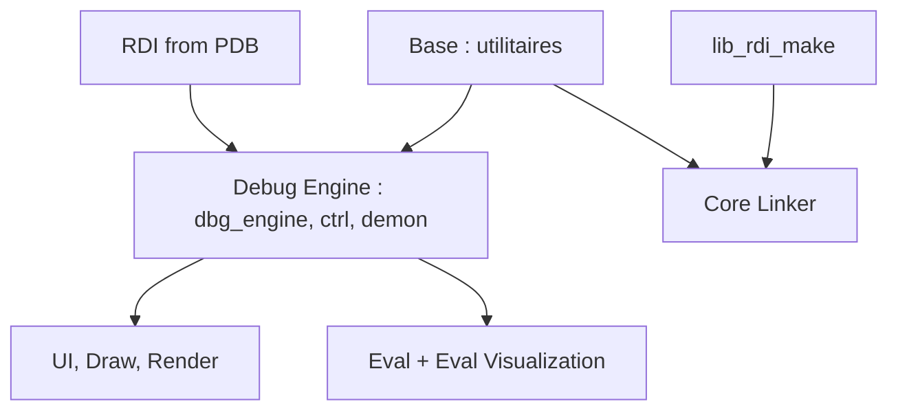

# EpicGamesExt/raddebugger

> Débogueur graphique natif x64 pour Windows et Linux, avec son propre format d'infos de debug et un éditeur de liens.

## Le problème
Les débogueurs et éditeurs de liens classiques peinent sur d'énormes exécutables, avec des fichiers PDB qui débordent leurs tables 32 bits.

## Ce que ça fait vraiment
Trois pièces : un débogueur graphique multi-processus (alpha, x64 local seulement), le format RDI vers lequel PDB et DWARF sont convertis à la demande, et le RAD Linker pour binaires PE/COFF, annoncé 50 % plus rapide sur de très gros projets. Le code est organisé en couches C à préfixes de noms, formant un graphe acyclique.

## Comment c'est branché


## Essayer
```bash
# Windows, depuis une invite MSVC x64
build
build release
build radlink release
# Linux
./build.sh
./build.sh release
```

## Coût et pièges
Gratuit. Windows : outils MSVC et SDK. Linux : GCC ou Clang et plusieurs bibliothèques de développement (freetype, X11, GL, EGL). Le débogueur est en alpha, Linux encore très tôt, et le README ne documente pas l'usage du débogueur.

## Ce que ce n'est pas
Ce n'est pas un débogueur de Python ni de code de modèles. Il ne gère ni le débogage distant ni les autres architectures que x64.

## Alternatives
Aucune alternative nommée dans le README.

## Pour toi
À ignorer : outil de débogage natif C/C++ en alpha, sans rapport avec le travail data / IA / MLOps courant.

