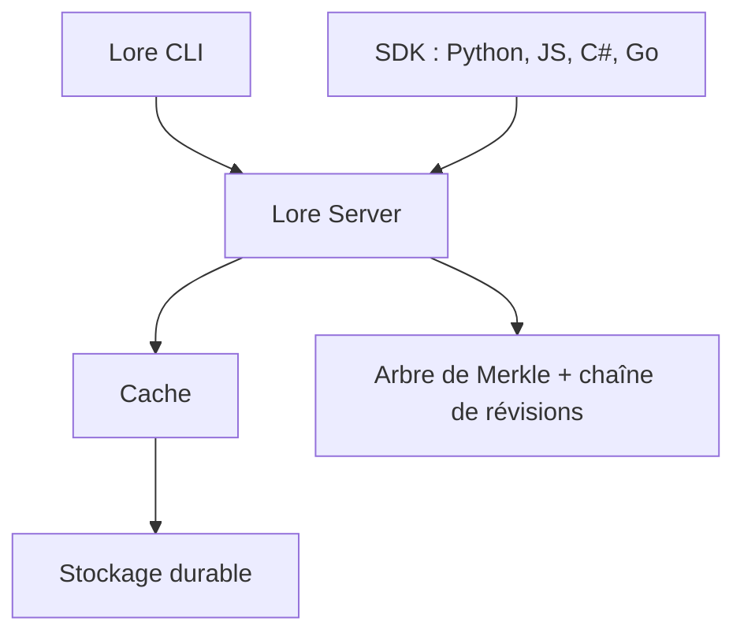

# EpicGames/lore

> Open-source version control system designed for large binary files, video games and mixed teams.

## The problem
Git struggles with large binary assets (textures, models, builds) and with very large teams. Artists and developers need a single tool that holds up under the load.

## What it actually does
Lore is a centralized, content-addressed version control system: the repository state is a Merkle tree with an immutable revision chain. Large files are split into reusable chunks, and workspaces fetch data on demand. A branch is just a lightweight reference. A CLI gives access to everything, plus C/C++, C#, Rust, Go, Python and JavaScript APIs.

## How it is wired
Simplified diagram based on the sheet, no diagram provided.



## Trying it
```bash
curl -fsSL https://raw.githubusercontent.com/EpicGames/lore/main/scripts/install.sh | bash -s -- --demo
```

## Cost and gotchas
Free (MIT). The project is pre-1.0: interfaces, on-disk formats and APIs may change between versions. The open-source client doesn't yet talk to the UEFN version, which uses a proprietary compression format.

## What it is not
Not a production-ready Git replacement: the README itself announces a pre-1.0 state. It is a centralized system, not distributed like Git. It targets projects with many binary assets, not code alone.

## Alternatives
No alternative named in the README (an FAQ compares Lore to other systems, but its content is not provided).

## For you
Keep an eye on it: games are not your field, but content-addressed storage with on-demand hydration may one day serve to version large datasets or models, once the format is stable.
