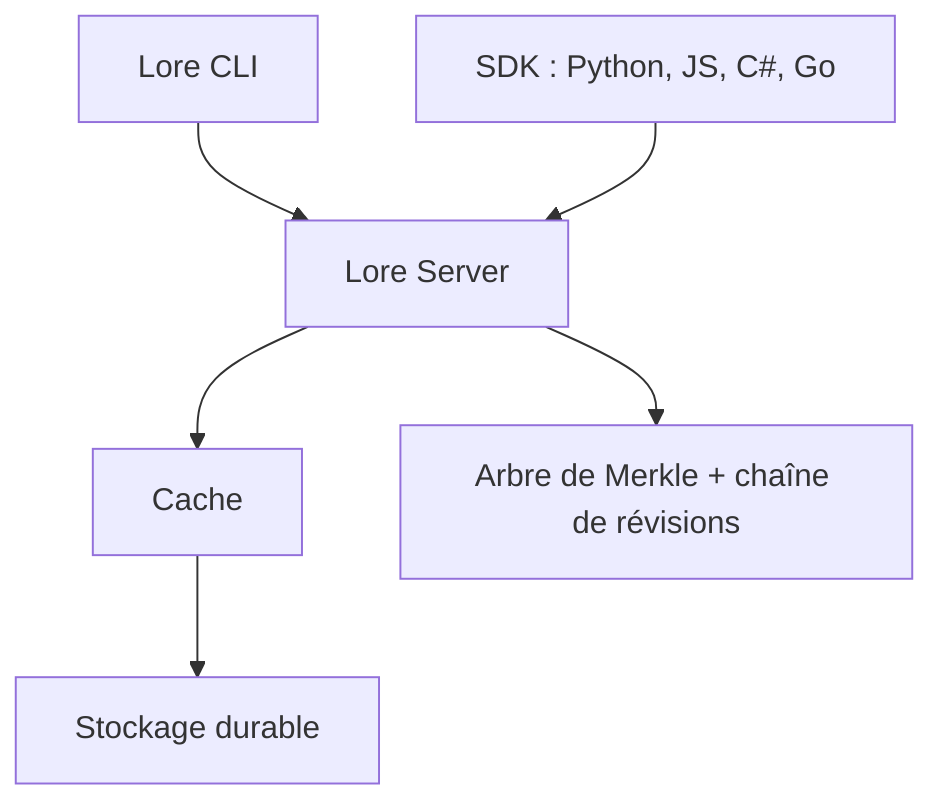

# EpicGames/lore

> Système de gestion de versions open source, pensé pour les gros fichiers binaires, jeux vidéo et équipes mixtes.

## Le problème
Git peine avec les gros assets binaires (textures, modèles, builds) et avec les très grandes équipes. Les artistes et les développeurs ont besoin d'un même outil qui tienne la charge.

## Ce que ça fait vraiment
Lore est un système de versions centralisé, adressé par contenu : l'état du dépôt est un arbre de Merkle avec une chaîne de révisions immuable. Les gros fichiers sont découpés en morceaux réutilisables, et les espaces de travail récupèrent les données à la demande. La branche est une simple référence légère. Une CLI donne accès à tout, plus des API C/C++, C#, Rust, Go, Python et JavaScript.

## Comment c'est branché
Schéma simplifié d'après la fiche, sans diagramme fourni.



## Essayer
```bash
curl -fsSL https://raw.githubusercontent.com/EpicGames/lore/main/scripts/install.sh | bash -s -- --demo
```

## Coût et pièges
Gratuit (MIT). Le projet est pré-1.0 : interfaces, formats sur disque et API peuvent changer entre versions. Le client open source ne dialogue pas encore avec la version UEFN, qui utilise un format de compression propriétaire.

## Ce que ce n'est pas
Ce n'est pas un remplaçant de Git prêt pour la production : le README annonce lui-même un état pré-1.0. C'est un système centralisé, pas distribué comme Git. Il vise les projets avec beaucoup d'assets binaires, pas le code seul.

## Alternatives
Aucune alternative nommée dans le README (une FAQ compare Lore à d'autres systèmes, mais son contenu n'est pas fourni).

## Pour toi
À surveiller : les jeux ne sont pas ton terrain, mais le stockage adressé par contenu avec hydratation à la demande peut un jour servir à versionner de gros jeux de données ou modèles, une fois le format stabilisé.

