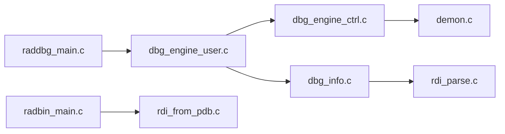

# EpicGames/raddebugger

> Native graphical debugger for x64 on Windows and Linux, with the RDI debug format and a linker.

## The problem
Debugging very large native executables is slow with current tools, and giant PDBs exceed their internal limits.

## What it actually does
Multi-process user-mode debugger that converts PDB and DWARF on demand to its own RDI format. The project adds `radbin` (conversion and dump) and the RAD Linker for PE/COFF, claimed to be 50% faster on large projects. The debugger is in alpha; Linux support is very early.

## How it is wired


## Trying it
```bash
build            # Windows, mode debug
build release
./build.sh       # Linux
./build.sh radlink release
```

## Cost and gotchas
Free. Built from source with MSVC or Clang (Windows) or GCC/Clang and X11/GL libraries (Linux). Alpha: expect bugs.

## What it is not
No remote or multi-machine debugging for now, and no architecture other than x64.

## Alternatives
- No alternative named in the README.

## For you
Ignore: native C/C++ debugging tool, unrelated to data/AI.
