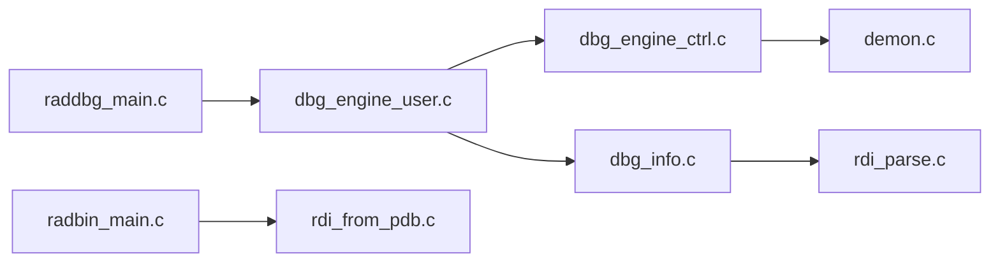

# EpicGames/raddebugger

> Débogueur graphique natif pour x64 sous Windows et Linux, avec format de debug RDI et éditeur de liens.

## Le problème
Déboguer de très gros exécutables natifs est lent avec les outils actuels, et les PDB géants dépassent leurs limites internes.

## Ce que ça fait vraiment
Débogueur utilisateur multi-processus qui convertit à la demande PDB et DWARF vers son propre format RDI. Le projet ajoute `radbin` (conversion et dump) et le RAD Linker pour PE/COFF, annoncé 50 % plus rapide sur de gros projets. Le débogueur est en alpha ; le support Linux est très précoce.

## Comment c'est branché


## Essayer
```bash
build            # Windows, mode debug
build release
./build.sh       # Linux
./build.sh radlink release
```

## Coût et pièges
Gratuit. Compilation depuis les sources avec MSVC ou Clang (Windows) ou GCC/Clang et bibliothèques X11/GL (Linux). Alpha : attends-toi à des bogues.

## Ce que ce n'est pas
Pas de débogage distant ni multi-machine pour l'instant, ni architecture autre que x64.

## Alternatives
- Aucune alternative nommée dans le README.

## Pour toi
À ignorer : outil de débogage C/C++ natif, sans rapport avec la data/IA.

