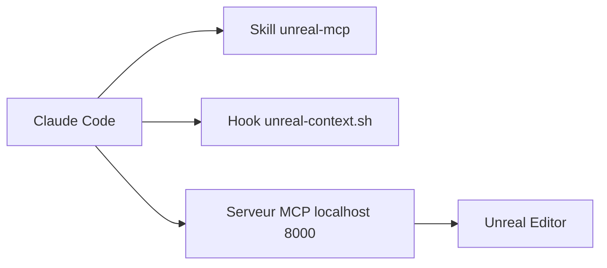

# EpicGames/unreal-engine-skills-for-claude-code-plugin

> A Claude Code plugin that drives the Unreal Engine editor through MCP, for game developers.

## The problem
Getting a coding assistant to work inside Unreal Editor means exposing the editor's actors, blueprints and materials to it.

## What it actually does
The plugin provides an `unreal-mcp` skill and a SessionStart hook that flags an Unreal project. The tools come from the editor's MCP server (ModelContextProtocol and AllToolsets plugins), on localhost:8000. A tool search exposes three meta-tools: `list_toolsets`, `describe_toolset`, `call_tool`.

## How it is wired
Simplified diagram based on the sheet, no diagram provided.



## Trying it
```bash
/plugin install unreal-engine-skills-for-claude-code@claude-plugins-official
/plugin marketplace add anthropics/claude-plugins-official
```

## Cost and gotchas
The Unreal editor must be running, with the MCP server started (`ModelContextProtocol.StartServer`) and a bash shell on the PATH. `execute_tool_script` runs arbitrary Python in the editor: commit before any session.

## What it is not
Not a standalone tool: without Unreal Editor open, no tool is exposed. No `.mcp.json` file is provided; it is generated from the editor.

## Alternatives
No alternative named in the README.

## For you
Ignore for a data, AI or MLOps profile: it only serves to drive Unreal Engine. Still useful if you do games or simulation with this engine.
