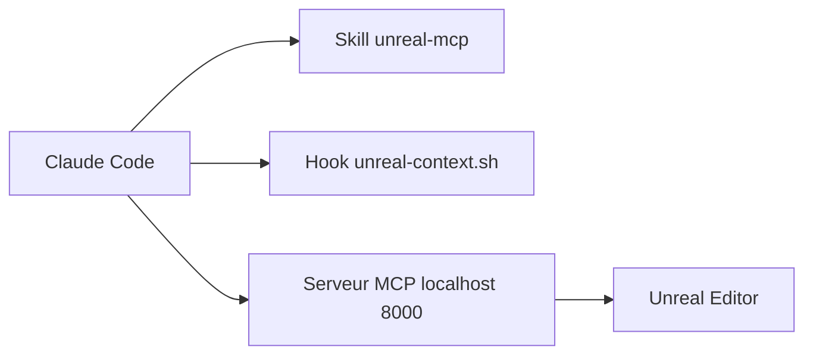

# EpicGames/unreal-engine-skills-for-claude-code-plugin

> Un plugin Claude Code qui pilote l'éditeur Unreal Engine par MCP, pour développeurs de jeux.

## Le problème
Faire travailler un assistant de code dans Unreal Editor suppose de lui exposer les acteurs, blueprints et matériaux de l'éditeur.

## Ce que ça fait vraiment
Le plugin apporte un skill `unreal-mcp` et un hook SessionStart qui signale un projet Unreal. Les outils viennent du serveur MCP de l'éditeur (plugins ModelContextProtocol et AllToolsets), sur localhost:8000. Une recherche d'outils expose trois méta-outils : `list_toolsets`, `describe_toolset`, `call_tool`.

## Comment c'est branché
Schéma simplifié d'après la fiche, sans diagramme fourni.



## Essayer
```bash
/plugin install unreal-engine-skills-for-claude-code@claude-plugins-official
/plugin marketplace add anthropics/claude-plugins-official
```

## Coût et pièges
Il faut l'éditeur Unreal lancé, avec le serveur MCP démarré (`ModelContextProtocol.StartServer`) et un shell bash dans le PATH. `execute_tool_script` exécute du Python arbitraire dans l'éditeur : à committer avant toute session.

## Ce que ce n'est pas
Pas un outil autonome : sans Unreal Editor ouvert, aucun outil n'est exposé. Pas de fichier `.mcp.json` fourni, il se génère depuis l'éditeur.

## Alternatives
Aucune alternative nommée dans le README.

## Pour toi
À ignorer pour un profil data, IA ou MLOps : il ne sert qu'à piloter Unreal Engine. Reste utile si tu fais du jeu ou de la simulation avec ce moteur.

