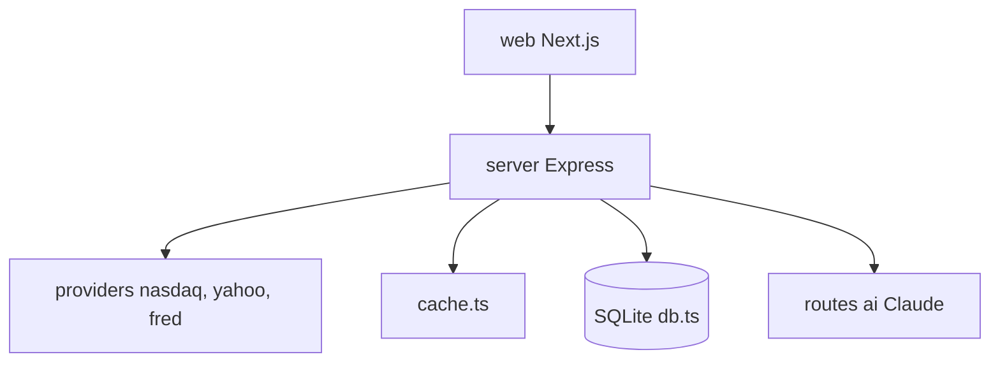

# ErTasselli/OpenTerminal

> Keyboard-driven stock dashboard made of widgets, built on free public data.

## The problem
Market terminals cost more than 2,000 dollars a month, and free dashboards rely on a single fragile source.

## What it actually does
A Next.js and Express application that aggregates several public endpoints (Nasdaq, Yahoo, TradingView, CoinGecko, Binance, FRED) with automatic fallback. Widgets: charts, quotes, news, market screener, heat map, options, crypto, macro, SQLite portfolio, calendar. A Claude assistant is optional.

## How it is wired


## Trying it
```bash
git clone https://github.com/ErTasselli/openterminal.git
cd openterminal
npm install
npm run dev
docker compose up --build
```

## Cost and gotchas
Free without a key. The assistant requires `ANTHROPIC_API_KEY`, at your expense. The sources are public endpoints without a data licence: prices are indicative, and the providers' terms of use apply. Two npm audit alerts are known.

## What it is not
Not a trading tool: the README forbids using it for investment decisions. Not a reliable data source in production. The last push dates from October 2026.

## Alternatives
None cited in the README.

## For you
Ignore: a nice dashboard example, but with unguaranteed data and no direct link to your MLOps work.
