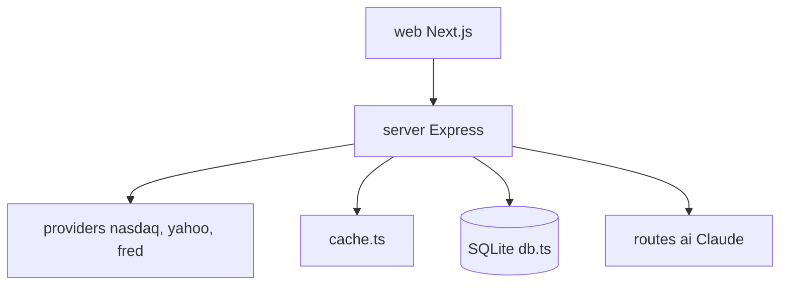

# ErTasselli/OpenTerminal

> Tableau de bord boursier à widgets, au clavier, construit sur des données publiques gratuites.

## Le problème
Les terminaux de marché coûtent plus de 2 000 dollars par mois et les tableaux de bord gratuits reposent sur une seule source fragile.

## Ce que ça fait vraiment
Une application Next.js et Express qui agrège plusieurs points d'accès publics (Nasdaq, Yahoo, TradingView, CoinGecko, Binance, FRED) avec repli automatique. Widgets : graphiques, cotations, actualités, filtre de marché, carte de chaleur, options, crypto, macro, portefeuille SQLite, calendrier. Un assistant Claude est optionnel.

## Comment c'est branché


## Essayer
```bash
git clone https://github.com/ErTasselli/openterminal.git
cd openterminal
npm install
npm run dev
docker compose up --build
```

## Coût et pièges
Gratuit sans clé. L'assistant exige `ANTHROPIC_API_KEY`, à ta charge. Les sources sont des points d'accès publics sans licence de données : prix indicatifs, et les conditions d'usage des fournisseurs s'appliquent. Deux alertes npm audit sont connues.

## Ce que ce n'est pas
Pas un outil de trading : le README interdit de s'en servir pour des décisions d'investissement. Pas une source de données fiable en production. Le dernier envoi date d'octobre 2026.

## Alternatives
Aucune citée dans le README.

## Pour toi
À ignorer : joli exemple de tableau de bord, mais des données non garanties et sans rapport direct avec ton MLOps.

