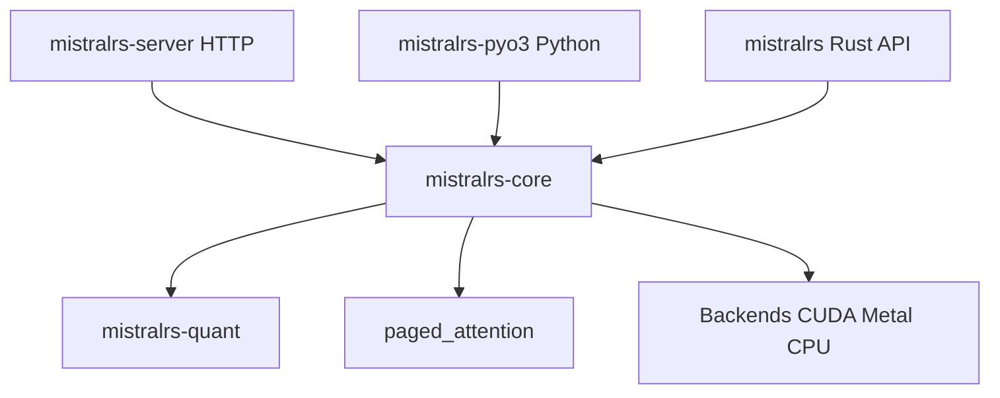

# EricLBuehler/mistral.rs

> Multimodal LLM inference engine in Rust, with OpenAI- and Anthropic-compatible APIs.

## The problem
Serving text, image, video and audio models locally requires assembling quantization, batching and an API server.

## What it actually does
`mistralrs serve` loads a Hugging Face or GGUF model, detects the architecture and template, and exposes an OpenAI-compatible `/v1` and Anthropic-compatible Messages endpoints. It includes quantization (ISQ, GGUF, GPTQ, AWQ), PagedAttention, LoRA, tool calling, Python and shell execution, an MCP client, a `/ui` web interface and Prometheus metrics. Python and Rust SDKs.

## How it is wired


## Trying it
```bash
curl -fsSL https://mistralrs.dev/install.sh | sh
mistralrs serve -m Qwen/Qwen3-4B --quant 4
pip install mistralrs
cargo add mistralrs
```
Interface at http://localhost:1234/ui.

## Cost and gotchas
Free, but a GPU (CUDA or Metal) is needed for good performance. The install script is run via `curl | sh`. Some memory options changed in v0.9.5.

## What it is not
Not affiliated with Mistral AI. The provided benchmarks also show cases where vLLM is clearly faster (BF16, Gemma 4 26B-A4B).

## Alternatives
llama.cpp: compared in Q8 in the benchmarks. vLLM: faster on some BF16 cases in the README.

## For you
Worth adopting to serve local models behind an OpenAI or Anthropic API, after measuring on your own hardware.
