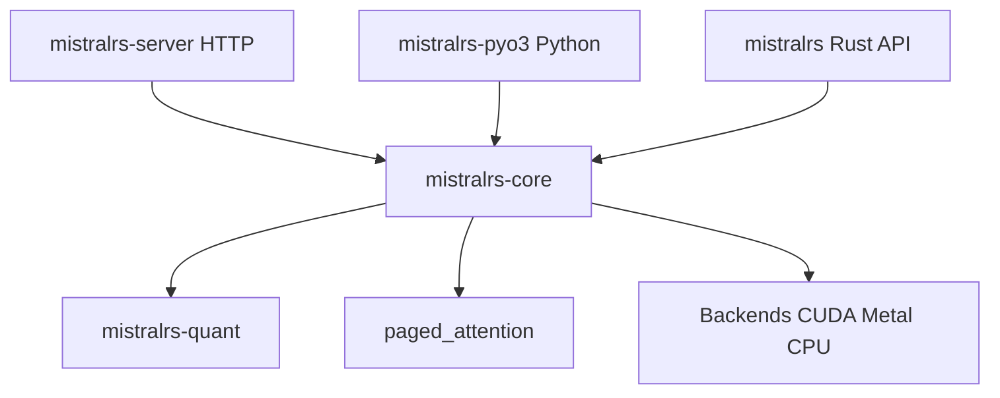

# EricLBuehler/mistral.rs

> Moteur d'inférence LLM en Rust, multimodal, avec API compatibles OpenAI et Anthropic.

## Le problème
Servir localement des modèles de texte, image, vidéo et audio demande d'assembler quantification, batching et serveur d'API.

## Ce que ça fait vraiment
`mistralrs serve` charge un modèle Hugging Face ou GGUF, détecte architecture et gabarit, et expose `/v1` compatible OpenAI et des endpoints Messages compatibles Anthropic. Il inclut quantification (ISQ, GGUF, GPTQ, AWQ), PagedAttention, LoRA, appel d'outils, exécution Python et shell, client MCP, interface web `/ui` et métriques Prometheus. SDK Python et Rust.

## Comment c'est branché


## Essayer
```bash
curl -fsSL https://mistralrs.dev/install.sh | sh
mistralrs serve -m Qwen/Qwen3-4B --quant 4
pip install mistralrs
cargo add mistralrs
```
Interface sur http://localhost:1234/ui.

## Coût et pièges
Gratuit, mais un GPU (CUDA ou Metal) est nécessaire pour de bonnes performances. Le script d'installation est exécuté via `curl | sh`. Des options mémoire ont changé en v0.9.5.

## Ce que ce n'est pas
Pas affilié à Mistral AI. Les benchmarks fournis montrent aussi des cas où vLLM est nettement plus rapide (BF16, Gemma 4 26B-A4B).

## Alternatives
llama.cpp : comparé en Q8 dans les benchmarks. vLLM : plus rapide sur certains cas BF16 du README.

## Pour toi
À adopter pour servir des modèles locaux derrière une API OpenAI ou Anthropic, avec mesure préalable sur ton matériel.

