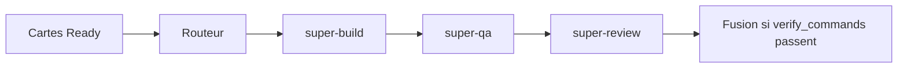

# EricTechPro/super-board

> Claude Code plugin that moves a GitHub ticket board forward through build, test and review lanes.

## The problem
Orchestrating several coding agents on a backlog, with tests and review, remains manual.

## What it actually does
A router classifies each card (easy, medium, hard) and picks the model. Three lanes: Build in a worktree with a draft PR, QA with a security review of the diff, Review with a merge guard. Protection hooks (secrets, keys, deletion outside the project, protected push). Nine skills in total, Codex mode possible.

## How it is wired
Simplified diagram based on the sheet, no diagram provided.


## Trying it
```bash
curl -fsSL https://raw.githubusercontent.com/EricTechPro/super-board/main/get.sh | bash
/super-board onboard
/super-board run my-app
```

## Cost and gotchas
Requires Claude Code, `gh` with access to the board, jq, bash and Python 3.9. Each card consumes tokens from Opus or Sonnet models at your expense. Installation runs a remote script directly.

## What it is not
It is not a guarantee of safe merging: that depends on your `verify_commands`. It is not autonomous without board configuration.

## Alternatives
No alternative named in the README.

## For you
Watch: interesting for automating a backlog with agents, but costly in tokens and single-maintainer.
