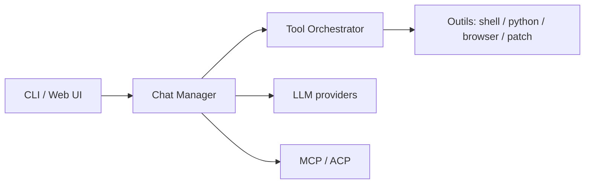

# ErikBjare/gptme

> Provider-independent AI agent in the terminal, for code and knowledge work.

## The problem
Coding agents are tied to a provider or an editor; you want the same agent over SSH, in CI or on a headless server.

## What it actually does
A CLI with tools: shell, Python, patch, browser (Playwright), vision, tmux, GitHub, sub-agents, RAG. It works with Anthropic, OpenAI, Google, xAI, DeepSeek, OpenRouter or llama.cpp locally. Plugin system, skills and lessons injected depending on context; MCP client and server; ACP for Zed and JetBrains; web interface and TUI; persistent autonomous agents (gptme-agent-template model, systemd service).

## How it is wired


## Trying it
```bash
pipx install gptme
gptme
gptme -n 'run the test suite and fix any failing tests'
```

## Cost and gotchas
At least one provider access (API key or subscription); tokens are at your expense, except for local models. The `-y` or `-n` mode runs tools without confirmation: reserve it for isolated environments.

## What it is not
Not an IDE. The README's comparison table with Claude Code, Cursor and Warp is written by the author. The demo recordings date from 2023.

## Alternatives
Claude Code, Codex, Cursor and Warp (compared in the README).

## For you
Worth adopting for a multi-provider CLI agent, scriptable in CI and extensible, with a project active since 2023.
