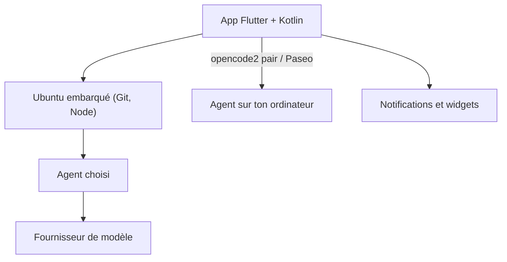

# Eslamasabry/opencode-mobile-next

> Android app that runs ten coding agents on the phone or drives those on your computer.

## The problem
Coding agents ask for approvals while you are away from your desk, and installing Linux and an agent on a phone is tedious.

## What it actually does
The app installs an Ubuntu with Git and Node, about 210 MB, and runs the chosen agent in it: Claude Code, Codex, Qwen Code, Cline, Goose, OpenCode and others. It offers chat, diff, terminal, Git, preview and widgets, and lets you approve a command from a notification. You can also connect to a computer's agent. Prompts can be scheduled.

## How it is wired
Simplified diagram based on the sheet, no diagram provided.



## Trying it
```bash
flutter pub get
flutter analyze
tool/qa/run_tests_fast.sh
```
To use it: download the APK from the latest release.

## Cost and gotchas
Android 8 or later, 64-bit for agents on the phone. You need a model provider key; OpenCode's free models work without a key. Installation goes through an APK outside the Play Store, and the README advises against uninstalling to repair an update, at the risk of losing projects.

## What it is not
It is not available on iOS, macOS, Linux or Windows. The README admits that several agents are little tested on real phones, with only Claude Code and OpenCode being the best proven. A native Kotlin rewrite is under way.

## Alternatives
- Termux + an agent CLI: manual installation but more freedom.
- AndCode: a neighbouring Android app, with four agents.

## For you
Watch: handy for approving an agent's requests remotely, but young and carried by a single person, so test before relying on it.
