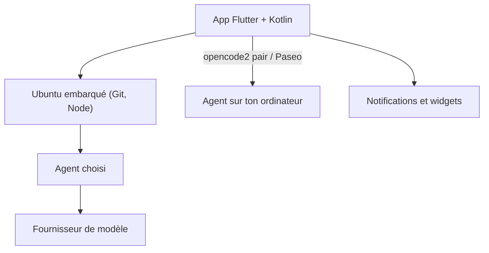

# Eslamasabry/opencode-mobile-next

> Application Android qui fait tourner dix agents de code sur le téléphone ou pilote ceux de ton ordinateur.

## Le problème
Les agents de code demandent des validations pendant que tu es loin de ton poste, et installer Linux et un agent sur un téléphone est fastidieux.

## Ce que ça fait vraiment
L'application installe un Ubuntu avec Git et Node, environ 210 Mo, et y fait tourner l'agent choisi : Claude Code, Codex, Qwen Code, Cline, Goose, OpenCode et d'autres. Elle offre chat, diff, terminal, Git, aperçu et widgets, et permet d'approuver une commande depuis une notification. On peut aussi se connecter à l'agent d'un ordinateur. Les prompts peuvent être planifiés.

## Comment c'est branché
Schéma simplifié d'après la fiche, sans diagramme fourni.



## Essayer
```bash
flutter pub get
flutter analyze
tool/qa/run_tests_fast.sh
```
Pour l'utiliser : télécharger l'APK depuis la dernière release.

## Coût et pièges
Android 8 ou plus, 64 bits pour les agents sur le téléphone. Il faut une clé de fournisseur de modèle ; les modèles gratuits d'OpenCode marchent sans clé. L'installation passe par un APK hors Play Store, et le README conseille de ne pas désinstaller pour réparer une mise à jour, au risque de perdre les projets.

## Ce que ce n'est pas
Ce n'est pas disponible sur iOS, macOS, Linux ni Windows. Le README admet que plusieurs agents sont peu testés sur de vrais téléphones, seuls Claude Code et OpenCode étant les mieux éprouvés. Une réécriture native en Kotlin est en cours.

## Alternatives
- Termux + une CLI d'agent : installation manuelle mais plus de liberté.
- AndCode : application Android voisine, avec quatre agents.

## Pour toi
À surveiller : pratique pour valider les demandes d'un agent à distance, mais jeune et porté par une seule personne, donc à tester avant de t'y fier.

