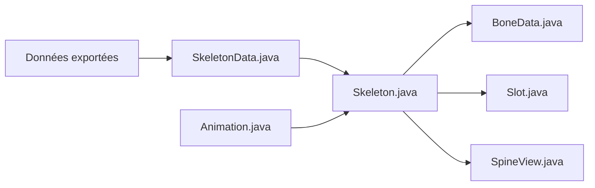

# EsotericSoftware/spine-runtimes

> Libraries for reading and playing the 2D skeletal animations of the Spine software in game engines.

## The problem
Animations created in the Spine editor do not display by themselves in a game; a runtime is needed for each platform.

## What it actually does
Runtimes in several languages and engines (LibGDX, C++, C#, TypeScript, Android, iOS, Godot). The principle: load the exported data, advance the animation state, update the skeleton pose (bones, slots, attachments, skins, timelines), then draw through the platform. Documentation specific to each runtime is in its folder.

## How it is wired


## Trying it
```bash
# aucune commande dans le README : voir le README.md de chaque dossier de runtime
```

## Cost and gotchas
Free evaluation. To distribute software containing the runtimes, a Spine license is required, and end users must have their own in some cases. GitHub does not identify the license: to be checked. README advice: pin the Spine editor version at the same time as the runtime version.

## What it is not
Not free in the open-source sense: the terms of use are those of the Spine contract. It is not the animation editor.

## Alternatives
No alternative named in the README.

## For you
Ignore: game animation tool under a commercial license, unrelated to data/AI/MLOps.
