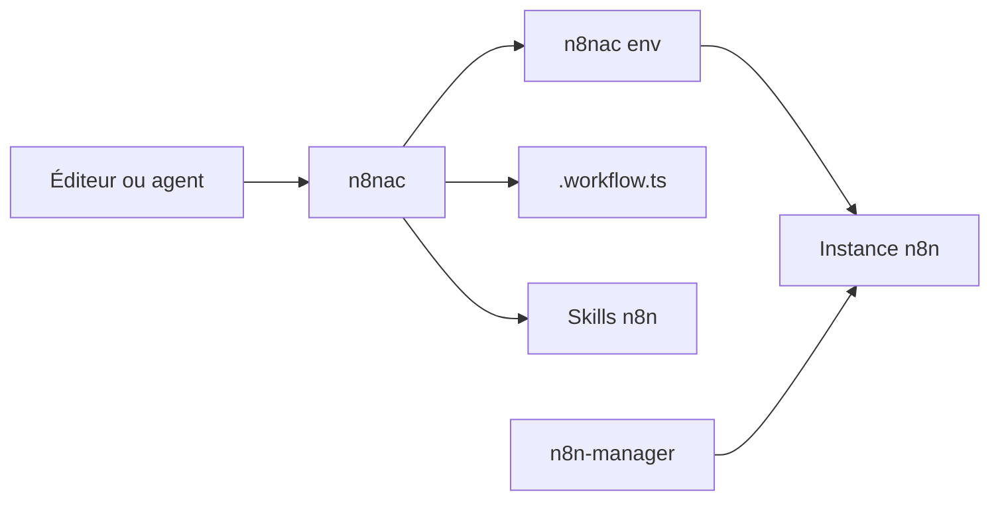

# EtienneLescot/n8n-as-code

> Toolkit to edit, version and deploy n8n workflows from the editor or an AI agent.

## The problem
n8n workflows live in the web interface: hard to review, to version and to have an AI agent manipulate cleanly.

## What it actually does
A CLI (`n8nac`) manages n8n environments, pulls and pushes workflows explicitly, and converts them into readable `.workflow.ts` files. A VS Code/Cursor extension and agent skills provide schemas, examples and validation rules. The `promote` command copies workflows from one environment to another, remapping credentials.

## How it is wired

Simplified diagram based on the sheet, no diagram provided.

## Trying it
```bash
npm install n8nac
npx --yes n8nac env add Dev --base-url https://n8n.example.com --workflows-path workflows/dev
printf '%s' "$N8N_API_KEY" | npx --yes n8nac env auth set Dev --api-key-stdin
npx --yes n8nac env use Dev
npx --yes n8nac list
npx --yes n8nac pull <workflow-id>
```

## Cost and gotchas
You need an n8n instance and its API key (stored locally, outside the repo). The node schema follows the latest stable n8n version: an older instance gives poorer results.

## What it is not
Neither an official n8n product (independent community project), nor a workflow execution engine. Synchronization stays manual: nothing is pushed without an explicit command.

## Alternatives
No alternative named in the README.

## For you
Worth watching: useful if you version n8n automation with an agent, but the project relies on a single person and is only a year old.
