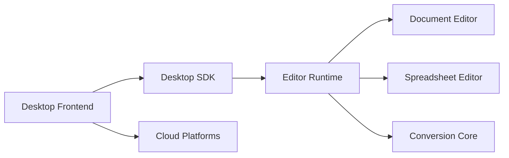

# Euro-Office/DesktopEditors

> Free offline office suite (word processor, spreadsheet, presentation, PDF), compatible with Office Open XML formats.

## The problem
Opening and editing .docx, .xlsx and .pptx files offline without proprietary software.

## What it actually does
Document, spreadsheet, presentation, form and PDF editors, a diagram viewer; connection to Nextcloud, ownCloud, Seafile and others; AI assistants, digital signatures, password protection. A super-repository with submodules: desktop-apps, desktop-sdk, core (conversion), sdkjs, web-apps, dictionaries.

## How it is wired


## Trying it
```bash
git clone https://github.com/Euro-Office/DesktopEditors.git
cd DesktopEditors
git submodule update --init --recursive
```

## Cost and gotchas
Free. The builds in the repository are community-made and unsigned; signed versions go through Nextcloud Office. License not identified by GitHub, while the README mentions AGPL v3: to be verified.

## What it is not
Not a lightweight editor: heavy compilation on three operating systems. The AI and cloud features are optional and require third-party services.

## Alternatives
Nextcloud Office Desktop Editors (signed versions, cited in the README).

## For you
Ignore: a general-purpose office suite with no link to data or AI, with a license to clarify.
