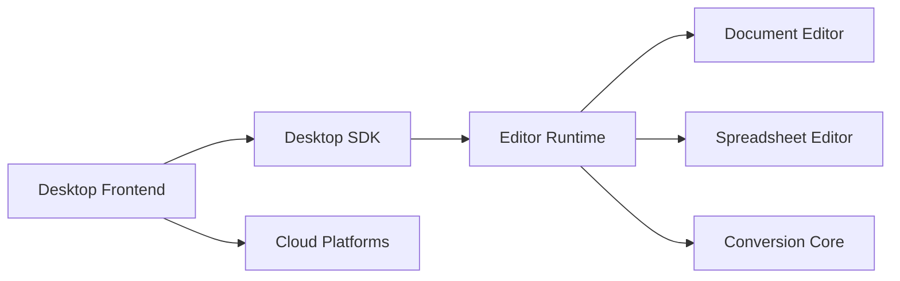

# Euro-Office/DesktopEditors

> Suite bureautique libre hors ligne (texte, tableur, présentation, PDF), compatible avec les formats Office Open XML.

## Le problème
Ouvrir et éditer des .docx, .xlsx et .pptx hors ligne sans logiciel propriétaire.

## Ce que ça fait vraiment
Éditeurs de documents, tableurs, présentations, formulaires et PDF, visionneuse de diagrammes ; connexion à Nextcloud, ownCloud, Seafile et autres ; assistants IA, signatures numériques, protection par mot de passe. Super-dépôt avec sous-modules : desktop-apps, desktop-sdk, core (conversion), sdkjs, web-apps, dictionnaires.

## Comment c'est branché


## Essayer
```bash
git clone https://github.com/Euro-Office/DesktopEditors.git
cd DesktopEditors
git submodule update --init --recursive
```

## Coût et pièges
Gratuit. Les builds du dépôt sont communautaires et non signés ; les versions signées passent par Nextcloud Office. Licence non identifiée par GitHub, alors que le README évoque l'AGPL v3 : à vérifier.

## Ce que ce n'est pas
Pas un éditeur léger : compilation lourde sur trois systèmes. Les fonctions IA et cloud sont optionnelles et nécessitent des services tiers.

## Alternatives
Nextcloud Office Desktop Editors (versions signées, citées dans le README).

## Pour toi
À ignorer : suite bureautique généraliste sans lien avec la data ou l'IA, avec une licence à clarifier.

