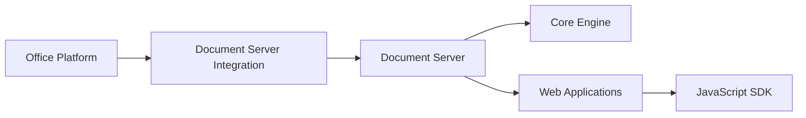

# Euro-Office/DocumentServer

> Sovereign office document editing server, meant to be plugged into a platform such as Nextcloud.

## The problem
Editing Office documents online often goes through services outside the organization's control.

## What it actually does
A server that is not standalone: it edits files stored by a third-party platform (Nextcloud). The repository contains the engine, JavaScript SDK, forms, web applications, fonts and dictionaries. The README does not explain the internal flow. A test Docker image is provided; signed builds go through Nextcloud Office.

## How it is wired


## Trying it
```bash
docker pull ghcr.io/euro-office/documentserver:latest
docker run -i -t -d -p 8080:80 --restart=always -e EXAMPLE_ENABLED=true -e JWT_SECRET=my_long_jwt_secret_at_least_32_chars ghcr.io/euro-office/documentserver:latest
```

## Cost and gotchas
Free. The repository builds are community builds, for testing; production goes through signed Nextcloud packages. A JWT secret of at least 32 characters is required.

## What it is not
Not a standalone office suite: without a storage platform, it is useless.

## Alternatives
Nextcloud Office (signed builds for production, cited in the README).

## For you
Ignore: office infrastructure building block unrelated to data or AI, unless you administer a Nextcloud.
