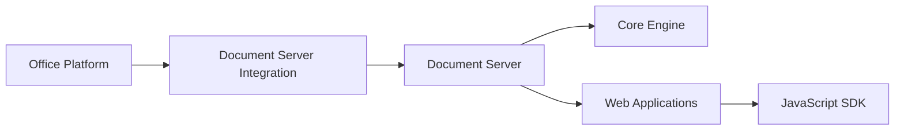

# Euro-Office/DocumentServer

> Serveur d'édition de documents bureautiques souverain, à brancher sur une plateforme comme Nextcloud.

## Le problème
Éditer des documents Office en ligne passe souvent par des services hors du contrôle de l'organisation.

## Ce que ça fait vraiment
Serveur qui n'est pas autonome : il édite des fichiers stockés par une plateforme tierce (Nextcloud). Le dépôt contient moteur, SDK JavaScript, formulaires, applications web, polices et dictionnaires. Le README n'explique pas le flux interne. Une image Docker de test est fournie ; les versions signées passent par Nextcloud Office.

## Comment c'est branché


## Essayer
```bash
docker pull ghcr.io/euro-office/documentserver:latest
docker run -i -t -d -p 8080:80 --restart=always -e EXAMPLE_ENABLED=true -e JWT_SECRET=my_long_jwt_secret_at_least_32_chars ghcr.io/euro-office/documentserver:latest
```

## Coût et pièges
Gratuit. Les builds du dépôt sont communautaires, pour test ; la production passe par des paquets signés de Nextcloud. Un secret JWT d'au moins 32 caractères est requis.

## Ce que ce n'est pas
Pas une suite bureautique autonome : sans plateforme de stockage, il ne sert à rien.

## Alternatives
Nextcloud Office (signed builds pour la production, cité dans le README).

## Pour toi
À ignorer : brique d'infrastructure bureautique sans lien avec la data ou l'IA, sauf si tu administres un Nextcloud.

