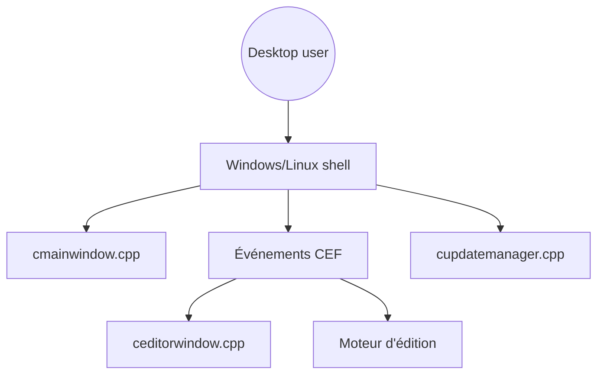

# Euro-Office/desktop-apps

> Interface of the desktop editors of a free, offline office suite compatible with Microsoft Office formats.

## The problem
Editing DOCX, XLSX and PPTX offline, without depending on a proprietary cloud provider.

## What it actually does
This repo contains only the front shell: main window, editing windows via CEF, login page, recent documents, templates, settings, and update management. The editing and conversion engine is in another repo. The README mentions AI integration, plugins, and connections to Nextcloud, ownCloud and Seafile.

## How it is wired
Diagram based on the code diagram.

## Trying it
No documented commands.

## Cost and gotchas
Free. Building from source requires the separate engine repo. The macOS code is represented only by headers. The AI plugs into a model of your choice, sometimes paid.

## What it is not
It is not a standalone suite you can build on its own: without the engine, the repo is not enough. The AGPL license requires sharing modifications.

## Alternatives
No alternative named in the README.

## For you
Ignore: an office suite, outside the data or MLOps field.
