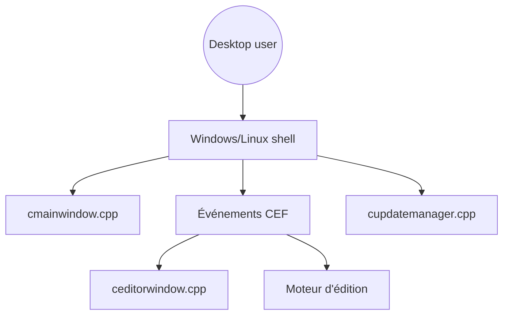

# Euro-Office/desktop-apps

> Interface des éditeurs de bureau d'une suite bureautique libre, hors ligne, compatible formats Microsoft Office.

## Le problème
Éditer des DOCX, XLSX et PPTX hors ligne, sans dépendre d'un fournisseur de cloud propriétaire.

## Ce que ça fait vraiment
Ce dépôt contient uniquement la coque frontale : fenêtre principale, fenêtres d'édition via CEF, page de connexion, documents récents, modèles, paramètres, et gestion des mises à jour. Le moteur d'édition et de conversion est dans un autre dépôt. Le README cite l'intégration d'IA, les plugins et les connexions à Nextcloud, ownCloud et Seafile.

## Comment c'est branché
Schéma d'après le diagramme du code.

## Essayer
Aucune commande documentée.

## Coût et pièges
Gratuit. La construction depuis les sources demande le dépôt du moteur séparé. Le code macOS n'est représenté que par des en-têtes. L'IA se branche sur un modèle de ton choix, parfois payant.

## Ce que ce n'est pas
Ce n'est pas une suite autonome à compiler seule : sans le moteur, le dépôt ne suffit pas. La licence AGPL impose le partage des modifications.

## Alternatives
Aucune alternative nommée dans le README.

## Pour toi
À ignorer : suite bureautique, hors du champ data ou MLOps.

